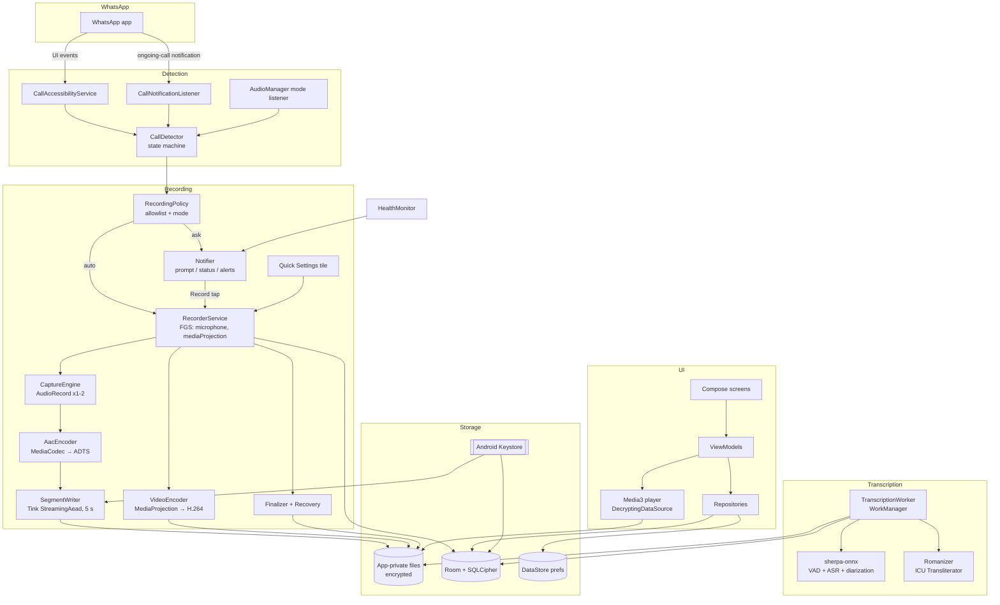
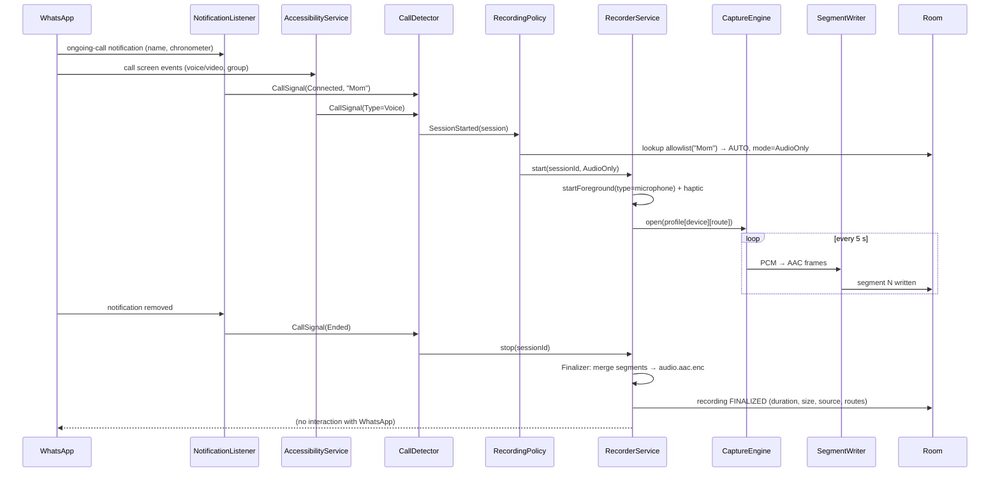
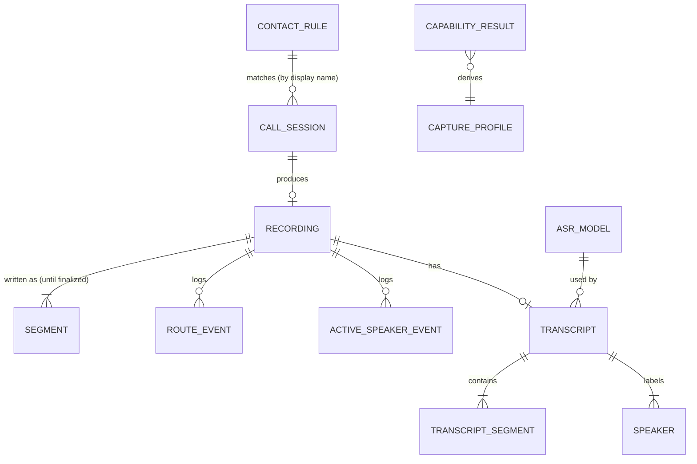

# Technical Design: WhatsApp Call Recorder (personal, on-device)
**Date**: 2026-10-18 | **Status**: Final — Approved (2026-10-19) | **Requirements**: [PRD (Approved)](../prds/2026-10-18_whatsapp-call-recorder_prd.md) · [Discovery (Approved)](2026-10-17_whatsapp-call-recording_discovery.md)

## 1. Overview
A native Android app (Kotlin, Jetpack Compose) that detects WhatsApp calls through a user-enabled **accessibility service** + **notification listener**, records call audio (optionally screen video) through a microphone-type **foreground service**, writes crash-safe **encrypted segments** to app-private storage, and later transcribes recordings **fully offline** with free open-licensed models (sherpa-onnx). No network permission, no backup, single owner, installed via ADB on a Galaxy A73 5G (Android 16) and Galaxy F42 5G (Android 13). Windows (phase 2) and WhatsApp Web (phase 3) get separate, smaller clients later.

**Design goals**
1. Correct capture first — every capture choice is data-driven from the M-001.1 spike, stored per device/route.
2. Never lose a recording — chunked writes, recovery on next start, health alerts (NFR-009, FR-040).
3. Privacy by construction — impossible to leak, not just "configured not to" (NFR-003/004).
4. Polished, smooth UI on the slower F42 (NFR-012..015).
5. Minimal dependencies — platform APIs first; every library justified (§2).

**Constraints** (from PRD/discovery): minSdk 33, targetSdk 36; no root/privileged install; no `INTERNET`; free/open-licensed models only; solo developer; local APK only.

### Approaches Considered
| # | Approach | Verdict |
|---|----------|---------|
| A | **Native Kotlin app**: accessibility + notification listener + `AudioRecord`/`MediaCodec`, Compose UI | **Chosen** — the core is Android system services; native gives direct control of audio sources, FGS types, Keystore, and the smallest footprint |
| B | Cross-platform (Flutter / React Native) with native plugins | Rejected — 80% of the work is native services anyway; bridge adds latency/complexity; no code reuse with Windows (different capture stack) |
| C | Automate Samsung's built-in Screen recorder (e.g. Tasker/intents) | Rejected — can't be triggered reliably without UI, no allowlist, files land in shared Gallery (privacy), mixed capture results |

## 2. Tech Stack Selection
| Layer | Choice | Why (vs alternatives) | Docs |
|-------|--------|-----------------------|------|
| Language | Kotlin 2.x + Coroutines/Flow | Android standard; structured concurrency for capture/encode pipelines. Java rejected (verbosity) | [link](https://kotlinlang.org/docs/home.html) |
| UI | Jetpack Compose + Material 3 | Required by NFR-012 (M3); dynamic color built in. XML Views rejected (slower to build polished motion) | [link](https://developer.android.com/develop/ui/compose/designsystems/material3) |
| Navigation | Navigation Compose (type-safe routes) | First-party, no extra concepts. Voyager/Decompose rejected (extra dependency) | [link](https://developer.android.com/develop/ui/compose/navigation) |
| Call detection | `AccessibilityService` + `NotificationListenerService` + `AudioManager` mode listener | Only non-root signals of WhatsApp call state; accessibility is also what unlocks concurrent mic capture | [a11y](https://developer.android.com/reference/android/accessibilityservice/AccessibilityService) · [NLS](https://developer.android.com/reference/android/service/notification/NotificationListenerService) · [mode](https://developer.android.com/reference/android/media/AudioManager#addOnModeChangedListener(java.util.concurrent.Executor,%20android.media.AudioManager.OnModeChangedListener)) |
| Audio capture | `AudioRecord` (16 kHz PCM, 1–2 instances) | Needed to pick the source chosen by the spike and to detect silence. `MediaRecorder` rejected (no PCM access, can't stereo-merge two sources). `AudioPlaybackCapture` rejected (excludes call audio) | [link](https://developer.android.com/reference/android/media/AudioRecord) · [concurrent capture](https://source.android.com/docs/core/audio/concurrent) |
| Audio encoding | `MediaCodec` AAC-LC → raw **ADTS** stream | Hardware encoder on both phones; ADTS is self-framing → a truncated file is still playable (crash safety) with no muxer. Opus rejected (needs Ogg muxing, encoder availability varies) | [link](https://developer.android.com/reference/android/media/MediaCodec) |
| Video | `MediaProjection` → `VirtualDisplay` → `MediaCodec` H.264 → `MediaMuxer` MP4 | Only non-root screen capture API. Samsung recorder rejected (see Approach C) | [link](https://developer.android.com/media/grow/media-projection) |
| Background execution | Foreground service types `microphone` (+ `mediaProjection` for video); WorkManager with `mediaProcessing` (API 35+) / `dataSync` (33–34) for transcription | Mandatory FGS types on Android 14+; WorkManager gives retry/resume and constraints (charging, idle) | [FGS types](https://developer.android.com/develop/background-work/services/fgs/service-types) · [WorkManager](https://developer.android.com/develop/background-work/background-tasks/persistent) |
| File encryption | Google **Tink** `StreamingAead` (AES256_GCM_HKDF_4KB), keyset wrapped by Android Keystore | Streaming + seekable decryption (playback seek without plaintext temp files). `androidx.security-crypto` rejected (deprecated). Hand-rolled `javax.crypto` rejected (easy to get nonce/segment handling wrong) | [link](https://developers.google.com/tink/streaming-aead) |
| Database | Room + **SQLCipher for Android** | Room = first-party typed SQLite with Flows + migrations. SQLCipher encrypts metadata and transcripts (they are call content). Plain Room rejected — transcripts in plaintext would undercut NFR-004 | [Room](https://developer.android.com/training/data-storage/room) · [SQLCipher](https://www.zetetic.net/sqlcipher/sqlcipher-for-android/) |
| Settings | Jetpack DataStore (Preferences) | Async, Flow-based. SharedPreferences rejected (sync I/O on main thread) | [link](https://developer.android.com/topic/libraries/architecture/datastore) |
| Playback | Media3 ExoPlayer + custom `DecryptingDataSource` | ADTS extractor with constant-bitrate seeking, speed control, background audio. `MediaPlayer` rejected (no custom data source for encrypted seek) | [link](https://developer.android.com/media/media3/exoplayer) |
| App lock | `androidx.biometric` (`BIOMETRIC_STRONG or DEVICE_CREDENTIAL`) | Platform prompt, fingerprint or PIN | [link](https://developer.android.com/identity/sign-in/biometric-auth) |
| Speech-to-text runtime | **sherpa-onnx** (Kotlin API, Apache-2.0) | One runtime for Whisper and IndicConformer ONNX models, plus Silero VAD and speaker diarization. whisper.cpp rejected as primary (Whisper-only, thinner Android API) — kept as bake-off candidate. Android `SpeechRecognizer` rejected (one language per session) | [repo](https://github.com/k2-fsa/sherpa-onnx) · [docs](https://k2-fsa.github.io/sherpa/onnx/) |
| ASR models (bake-off, M-013.1) | whisper small/medium (MIT), AI4Bharat IndicConformer (MIT, verify), IndicWhisper (verify) | Free, offline; licence verified per model before adoption | [IndicConformer](https://huggingface.co/ai4bharat/indic-conformer-600m-multilingual) · [whisper.cpp](https://github.com/ggml-org/whisper.cpp) |
| Romanization | `android.icu.text.Transliterator` (`Devanagari-Latin`, `Telugu-Latin`, then `Latin-ASCII`) + Hindi schwa-deletion pass | Built into Android (API 29+), zero dependency. AI4Bharat IndicXlit rejected for v1 (another model, ~100 MB) — revisit if quality poor | [link](https://developer.android.com/reference/android/icu/text/Transliterator) |
| DI | Manual constructor injection (`AppContainer`) | Single-module-ish solo app; Hilt rejected (annotation processing, build time, learning cost for little gain) | — |
| Build | Gradle Kotlin DSL + version catalog + dependency verification | Reproducible, pinned dependencies (supply chain) | [catalog](https://docs.gradle.org/current/userguide/version_catalogs.html) · [verification](https://docs.gradle.org/current/userguide/dependency_verification.html) |
| Fonts | System default (respects Samsung font settings) | "Native next to One UI" (NFR-012); no bundled or downloadable fonts (downloadable fonts rely on network provider) | — |
| Windows (phase 2) | .NET 8 + WinUI 3 + Windows **application loopback** (process-specific) + NAudio for mic | Process loopback isolates WhatsApp audio cleanly; detailed in a later design | [WinUI 3](https://learn.microsoft.com/windows/apps/winui/winui3/) · [loopback sample](https://learn.microsoft.com/samples/microsoft/windows-classic-samples/applicationloopbackaudio-sample/) · [NAudio](https://github.com/naudio/NAudio) |
| Web (phase 3) | Chrome/Edge MV3 extension: `tabCapture` + offscreen document + `MediaRecorder` + `downloads` | Only way to capture a tab's call audio locally | [tabCapture](https://developer.chrome.com/docs/extensions/reference/api/tabCapture) · [offscreen](https://developer.chrome.com/docs/extensions/reference/api/offscreen) |

**Dependency cost summary**: Media3 (~1.5 MB), Room (~0.5 MB), SQLCipher (~3–7 MB native), Tink (~1 MB), sherpa-onnx (~15–30 MB native, only in `:asr` module), models (100 MB–1 GB, imported at runtime, not in APK). Everything else is platform/AndroidX.

## 3. System Architecture


**Components and responsibilities**
| Component | Responsibility | Key APIs / notes |
|-----------|----------------|------------------|
| `CallAccessibilityService` | Receives WhatsApp window/content events (`packageNames=com.whatsapp,com.whatsapp.w4b`); reads call screen (name, voice/video, group, active-speaker tile); hosts the "accessibility" identity that allows concurrent mic capture; can take screenshots for FR-050 | `canRetrieveWindowContent`, `canTakeScreenshot`, `flagReportViewIds` |
| `CallNotificationListener` | Watches WhatsApp's ongoing-call notification (category `call`, chronometer = connected) → reliable start/end + display name even with screen off | `onNotificationPosted/Removed` |
| AudioManager mode listener | `MODE_IN_COMMUNICATION` = some VoIP call active; corroborates/ends sessions | API 31+ listener |
| `CallDetector` | Pure-Kotlin state machine fusing the 3 signals into `CallSession` events (Ringing → Connected → Ended; reconnect window 30 s; hold/second call). Rules for WhatsApp strings live in a versioned `DetectionRules` JSON asset (update without code change) | Unit-tested with fixtures from M-001.2 |
| `RecordingPolicy` | Decides auto / ask / ignore from allowlist (contact or group), per-contact mode override, global mode | Pure Kotlin |
| `RecorderService` | Foreground service; owns one active `RecordingJob`; notification with timer/Stop/"Capture other side (speaker)" | FGS type `microphone`; adds `mediaProjection` after video consent |
| `CaptureEngine` | Opens the `AudioRecord` source(s) from the device's `CaptureProfile` (spike result) for the current route; stereo L=own, R=remote when two sources work, else mono; re-opens on route change ≤ 1 s; computes RMS for capability/silence | `AudioDeviceCallback`, `AudioRecord.Builder` |
| `AacEncoder` | PCM → AAC-LC ADTS (16 kHz, 32 kbps mono / 48 kbps stereo ≈ 0.24–0.36 MB/min) | Bounded synchronous `MediaCodec` API on recording worker; avoids separate callback ownership (implementation decision 2026-10-20) |
| `SegmentWriter` | Every 5 s closes an encrypted segment file `seg_NNNNN.enc` (complete Tink ciphertext) and records it in DB → crash loses ≤ 5 s | Tink `StreamingAead`, associated data = recordingId+index |
| `Finalizer` / Recovery | On stop: concatenate segments' plaintext into one Tink stream `audio.aac.enc`, mux video if any, write metadata, delete segments. On app/boot start: finalize any `RECORDING` rows as `RECOVERED` | Idempotent |
| `HealthMonitor` | Checks accessibility enabled, notification-listener enabled, battery unrestricted, notifications allowed, storage; on app start, boot, and every 15 min (WorkManager) | Raises banner + notification with deep link |
| `TranscriptionWorker` | Decrypt → decode to 16 kHz PCM → VAD → (diarization) → ASR per segment → romanize → store segments; checkpoints `last_segment_ms` for resume | WorkManager, FGS `mediaProcessing`/`dataSync` |
| `Romanizer` | Native-script → casual Latin ("నేను రేపు వస్తాను" → "nenu repu vastanu"); English passes through | ICU + schwa-deletion rules |
| Repositories / ViewModels / UI | Unidirectional data flow; Room Flows are source of truth | §7 |

**Applicable standards**: [OWASP MASVS v2](https://mas.owasp.org/MASVS/) (storage, crypto, privacy, resilience), [WCAG 2.2 AA](https://www.w3.org/TR/WCAG22/) (via Android accessibility guidance), [Material Design 3](https://m3.material.io/).

## 4. Key Workflows

### 4.1 Allowlisted call → automatic recording

Background-start note: `RecorderService` is started from the accessibility service's process. Whether Android 14+ allows a `microphone` FGS to start from that context without a visible activity is **verified in M-001.1**; fallback = start the FGS once at service connect and keep it in a low-priority "Ready" state (persistent notification), switching to "Recording" on demand.

### 4.2 Non-allowlisted call → prompt
`POL` returns ASK → `Notifier` posts "Record this call?" (immutable `PendingIntent` → `RecorderService.ACTION_START`). Tapping is a user action → FGS start is always allowed. Notification is cancelled on `SessionEnded`.

### 4.3 Video call (Audio + Video mode)
```mermaid
sequenceDiagram
  participant CD as CallDetector
  participant RS as RecorderService
  participant PA as ProjectionActivity (translucent)
  participant MP as MediaProjection
  participant VE as VideoEncoder
  CD->>RS: SessionStarted(type=Video)
  RS->>RS: start audio recording immediately
  RS->>PA: full-screen-intent / heads-up "Tap to record video"
  PA->>MP: createScreenCaptureIntent()
  alt user taps Start
    MP-->>RS: projection token
    RS->>RS: startForeground(types=microphone|mediaProjection)
    RS->>VE: VirtualDisplay 720p → H.264 → video.mp4 (app-private, temp)
  else dismissed / denied
    RS->>RS: continue audio-only; fallback_reason="video consent dismissed"
  end
  CD->>RS: SessionEnded
  RS->>RS: mux audio + video → encrypt → video.mp4.enc; delete temp
```
Video temp file is plaintext only inside app-private storage during the call (MP4 needs a seekable output); encrypted at finalize, and Recovery encrypts any leftover temp. Accepted trade-off (AD-008).

### 4.4 Crash / kill recovery
On `Application.onCreate`, `BOOT_COMPLETED`, and `MY_PACKAGE_REPLACED`: `Recovery` finds `recording.status = RECORDING` rows with no live service → merges existing segments (≤ 5 s lost) → status `RECOVERED`. Partial segment files that fail Tink authentication are discarded (they are the in-flight ≤ 5 s).

### 4.5 Offline transcription
```mermaid
sequenceDiagram
  participant UI as Player/Library
  participant WM as WorkManager
  participant TW as TranscriptionWorker
  participant DEC as Decrypt+Decode
  participant SO as sherpa-onnx
  participant RZ as Romanizer
  participant DB as Room (FTS)
  UI->>WM: enqueue(recordingId) [or auto: charging+idle]
  WM->>TW: doWork() as FGS mediaProcessing/dataSync
  TW->>DB: transcript(status=RUNNING, resume_from=last_segment_ms)
  TW->>DEC: Tink seekable channel → MediaExtractor/MediaCodec → 16 kHz PCM
  TW->>SO: VAD → speech chunks (≤ 30 s)
  TW->>SO: diarization (mono) or channel split (stereo)
  loop each chunk
    TW->>SO: ASR(chunk) → text (native script / Latin)
    TW->>RZ: romanize(text) → casual Latin
    TW->>DB: insert segment(start,end,speaker,romanized,native) + checkpoint
  end
  TW->>DB: status=DONE; FTS index updated by triggers
```
Speaker labelling: stereo → L="You", R=contact. Mono → diarization clusters; the cluster closest to the owner's **voice print** (20 s enrolment recorded during onboarding, speaker-embedding model in sherpa-onnx) = "You"; the other = contact name (1:1) or "Participant N" (group, FR-049), upgraded by active-speaker log when available (FR-050).

## 5. Data Model

### 5.1 High-Level (entities & relationships)

**Ownership boundaries**: everything is owned by the single local owner; no tenancy. Detection writes `CALL_SESSION`; recording writes `RECORDING`/`SEGMENT`/`ROUTE_EVENT`; transcription writes `TRANSCRIPT*`/`SPEAKER`; UI only edits titles, stars, speaker labels, transcript text, rules and settings.

### 5.2 Low-Level Schema
SQLite via Room + SQLCipher. Times are epoch ms (`INTEGER`). Enums stored as `TEXT`. All FKs `ON DELETE CASCADE` unless noted.

| Table | Column | Type | Null | Index | Notes |
|-------|--------|------|------|-------|-------|
| contact_rule | id | INTEGER PK | N | PK | autoincrement |
| | display_name | TEXT | N | | as shown in WhatsApp / contacts |
| | match_key | TEXT | N | UNIQUE(kind, match_key) | NFKC, lower-case, emoji/space-normalized |
| | kind | TEXT | N | | `CONTACT` \| `GROUP` |
| | mode_override | TEXT | Y | | `AUDIO` \| `AUDIO_VIDEO`; null = global (FR-007) |
| | created_at | INTEGER | N | | |
| call_session | id | INTEGER PK | N | PK | |
| | wa_display_name | TEXT | Y | idx | null → "Unknown" |
| | match_key | TEXT | Y | idx | for allowlist lookup |
| | is_group | INTEGER(bool) | N | | |
| | group_name | TEXT | Y | | |
| | participants_json | TEXT | Y | | names visible on call screen |
| | direction | TEXT | N | | `INCOMING` \| `OUTGOING` \| `UNKNOWN` |
| | call_type | TEXT | N | | `VOICE` \| `VIDEO` (initial) |
| | ringing_at / connected_at / ended_at | INTEGER | Y | idx(connected_at) | |
| | decision | TEXT | N | | `AUTO` \| `ASKED` \| `MANUAL` \| `IGNORED` |
| recording | id | TEXT PK (UUIDv4) | N | PK | also directory name |
| | session_id | INTEGER FK → call_session | Y | idx | SET NULL on delete |
| | title | TEXT | Y | | user rename; default derived |
| | status | TEXT | N | idx | `RECORDING` \| `FINALIZED` \| `RECOVERED` \| `FAILED` |
| | started_at | INTEGER | N | idx | |
| | duration_ms | INTEGER | Y | | |
| | size_bytes | INTEGER | Y | | |
| | channels | INTEGER | N | | 1 or 2 (L=own, R=remote) |
| | capture_source | TEXT | N | | e.g. `VOICE_COMMUNICATION`, `MIC+SPEAKER` |
| | remote_captured | INTEGER(bool) | Y | | from silence detection on remote/mixed |
| | has_video | INTEGER(bool) | N | | |
| | fallback_reason | TEXT | Y | | e.g. video consent dismissed |
| | starred | INTEGER(bool) | N | | excluded from retention |
| | audio_path / video_path | TEXT | Y | | relative to `filesDir/rec/` |
| segment | recording_id | TEXT FK | N | PK(recording_id, idx) | deleted after finalize |
| | idx | INTEGER | N | | |
| | duration_us | INTEGER | N | | complete AAC frames; persists retry offsets after partial segment cleanup |
| | plain_bytes | INTEGER | N | | |
| | written_at | INTEGER | N | | |
| route_event | id | INTEGER PK | N | | |
| | recording_id | TEXT FK | N | idx | |
| | at_ms | INTEGER | N | | offset from start |
| | route | TEXT | N | | `EARPIECE` \| `SPEAKER` \| `WIRED` \| `BLUETOOTH` \| `USB` |
| active_speaker_event | id | INTEGER PK | N | | FR-050 |
| | recording_id | TEXT FK | N | idx(recording_id, at_ms) | |
| | at_ms | INTEGER | N | | |
| | name | TEXT | N | | highlighted tile name |
| | method | TEXT | N | | `TREE` \| `SCREENSHOT` |
| transcript | id | INTEGER PK | N | | |
| | recording_id | TEXT FK | N | UNIQUE | one per recording |
| | model_id | INTEGER FK → asr_model | Y | | SET NULL |
| | status | TEXT | N | idx | `QUEUED` \| `RUNNING` \| `DONE` \| `FAILED` |
| | progress | REAL | N | | 0..1 |
| | resume_from_ms | INTEGER | N | | checkpoint |
| | error | TEXT | Y | | |
| | updated_at | INTEGER | N | | |
| transcript_segment | id | INTEGER PK | N | | |
| | transcript_id | INTEGER FK | N | idx(transcript_id, start_ms) | |
| | start_ms / end_ms | INTEGER | N | | |
| | speaker_key | TEXT | N | | `SELF`, `REMOTE`, `P1`, `P2`… |
| | romanized | TEXT | N | | primary line (FR-042) |
| | native | TEXT | Y | | Devanagari/Telugu line; null if all-English |
| | lang | TEXT | Y | | `hi` \| `te` \| `en` \| `mixed` |
| | edited | INTEGER(bool) | N | | FR-047 |
| transcript_fts | (FTS4, external content = transcript_segment) | romanized, native | — | — | kept in sync by Room `@Fts4(contentEntity=…)` |
| speaker | transcript_id | INTEGER FK | N | PK(transcript_id, speaker_key) | |
| | label | TEXT | N | | "You", contact name/number, "Participant 1"… |
| | source | TEXT | N | | `CHANNEL` \| `VOICEPRINT` \| `HIGHLIGHT` \| `USER` |
| asr_model | id | INTEGER PK | N | | |
| | name / family | TEXT | N | | e.g. `indicconformer-600m-int8` / `INDICCONFORMER` |
| | dir_path | TEXT | N | | `filesDir/models/<id>/` |
| | sha256 | TEXT | N | UNIQUE | verified on import |
| | license | TEXT | N | | recorded at import (US-048) |
| | size_bytes | INTEGER | N | | |
| | active | INTEGER(bool) | N | | exactly one active (enforced in repo) |
| capability_result | id | INTEGER PK | N | | M-001.1 / FR-022 |
| | device_model / os_build / wa_version | TEXT | N | | |
| | route / source | TEXT | N | idx(route, source) | |
| | own_rms_db / remote_rms_db | REAL | Y | | |
| | own_ok / remote_ok | INTEGER(bool) | N | | threshold −50 dBFS |
| | tested_at | INTEGER | N | | |

**Derived, not stored**: `CaptureProfile` (best source per route) = computed from latest `capability_result` rows, cached in DataStore.

**DataStore keys**: `recording_mode` (default `AUDIO`), `theme` (`SYSTEM`), `dynamic_color` (true), `app_lock` (false), `auto_transcribe_on_charge` (false), `retention_days` (null = off), `onboarding_done`, `voiceprint_ready`, `capture_profile_json`, `detection_rules_version`.

**Files** (`filesDir/`, never external):
```text
rec/<recordingId>/seg_00001.enc …   # while recording (Tink ciphertext, 5 s each)
rec/<recordingId>/audio.aac.enc     # finalized (Tink, seekable)
rec/<recordingId>/video.mp4.enc     # optional
models/<modelId>/…                  # imported ONNX + tokens (not encrypted; public models)
voiceprint.enc                      # owner speaker embedding (Tink AEAD)
logs/app.log (ring, 1 MB)           # local diagnostics, names redacted
```

### 5.3 Migrations & Versioning
- Room `exportSchema = true`; schema JSON committed under `app/schemas/`; every version bump ships an explicit `Migration` + a `MigrationTestHelper` test. No destructive fallback (user data).
- SQLCipher passphrase: 32 random bytes generated once, wrapped with a Tink `Aead` whose keyset is protected by an Android Keystore master key; stored in DataStore.
- File format versioning: Tink ciphertext header + associated data `"v1|<recordingId>|<kind>"`; future formats bump `v`.
- `DetectionRules` JSON asset carries its own `version`; app logs which version detected each session.

## 6. API Design
There is **no network API** — by design (NFR-003). Contracts are in-process Kotlin interfaces and Android intents. Style: Kotlin `suspend` functions + `Flow`, errors as sealed `Result` types; no exceptions across module boundaries.

### 6.1 Internal module contracts
| Contract | Operation | Input | Output | Errors |
|----------|-----------|-------|--------|--------|
| `CallDetector` | `sessions: Flow<CallEvent>` | signals from a11y/NLS/AudioManager | `Started(session)`, `TypeChanged`, `Ended` | — (unknown signals logged) |
| `RecordingPolicy` | `decide(session)` | `CallSession` | `Auto(mode)` \| `Ask` \| `Ignore` | — |
| `RecorderController` | `start(sessionId?, mode)` / `stop()` / `enableSpeakerCapture()` | | `StateFlow<RecorderState>` | `NoMicPermission`, `CaptureSilent`, `LowStorage`, `FgsStartDenied` |
| `CaptureEngine` | `open(profile, route)` | `CaptureProfile`, `AudioRoute` | `Flow<PcmFrame>` | `SourceUnavailable(source)` |
| `RecordingRepository` | `observeAll(filter)`, `rename`, `delete`, `star`, `exportTo(uri)` | `RecordingFilter` | `Flow<List<RecordingSummary>>` | `NotFound`, `IoError` |
| `CryptoStore` | `openWriter(recId, idx)`, `openSeekableReader(path)` | | `WritableByteChannel` / `SeekableByteChannel` | `AuthFailed` |
| `TranscriptionService` | `enqueue(recId)`, `observe(recId)` | | `Flow<TranscriptState>` | `NoModel`, `ModelCorrupt`, `DecodeFailed` |
| `TranscriptRepository` | `search(query)`, `editSegment`, `renameSpeaker` | | `Flow<List<SearchHit>>` | — |
| `ModelManager` | `import(uri)`, `activate(id)` | SAF `Uri` | `AsrModel` | `ChecksumMismatch`, `UnsupportedLayout`, `TooLarge` |
| `HealthMonitor` | `status: StateFlow<Health>` | | list of `Issue(type, fixIntent)` | — |

### 6.2 Android entry points (manifest)
| Component | Exported | Protection | Purpose |
|-----------|----------|------------|---------|
| `MainActivity` | yes (launcher) | — | UI |
| `CallAccessibilityService` | yes | `BIND_ACCESSIBILITY_SERVICE` | detection + capture identity |
| `CallNotificationListener` | yes | `BIND_NOTIFICATION_LISTENER_SERVICE` | detection |
| `RecordTileService` | yes | `BIND_QUICK_SETTINGS_TILE` | manual start/stop (US-020) |
| `RecorderService` | no | — | FGS `microphone\|mediaProjection` |
| `BootReceiver` | yes (system broadcasts only) | `RECEIVE_BOOT_COMPLETED` | recovery + health (US-032) |
| `ProjectionActivity` | no | — | MediaProjection consent |

Notification actions use explicit, `FLAG_IMMUTABLE` `PendingIntent`s: `ACTION_START`, `ACTION_STOP`, `ACTION_SPEAKER_CAPTURE`, `ACTION_FIX(issue)`.

**Permissions**: `RECORD_AUDIO`, `POST_NOTIFICATIONS`, `FOREGROUND_SERVICE`, `FOREGROUND_SERVICE_MICROPHONE`, `FOREGROUND_SERVICE_MEDIA_PROJECTION`, `FOREGROUND_SERVICE_DATA_SYNC`, `FOREGROUND_SERVICE_MEDIA_PROCESSING`, `RECEIVE_BOOT_COMPLETED`, `REQUEST_IGNORE_BATTERY_OPTIMIZATIONS`, `USE_BIOMETRIC`, `VIBRATE`, `MODIFY_AUDIO_SETTINGS` (speaker fallback only). **Not requested**: `INTERNET`, `READ_CONTACTS` (contact picker `ACTION_PICK` returns a single contact without it), storage permissions (SAF only).

## 7. Frontend & UI Design

### Route Map
"Gated" = behind biometric lock when App lock is on (FR-019). Single user → no roles.
| Route | Access | Purpose |
|-------|--------|---------|
| `onboarding` | Open | Checklist + voice-print enrolment (FR-035) |
| `home` | Gated | Status, recent, storage (FR-036) |
| `library?contact={key}&from={d}&to={d}` | Gated | Grouped list + filters (FR-015/016/038); filters in route args (URL state) |
| `player/{recordingId}` | Gated | Player + transcript pane (FR-037/044) |
| `search?q={q}` | Gated | Transcript search (FR-046) |
| `allowlist` | Gated | Contacts and groups (FR-010/031/007) |
| `settings` | Gated | Mode, theme, lock, retention, transcription |
| `settings/capability` | Gated | Capability test (FR-022) |
| `settings/models` | Gated | Import/activate ASR model (FR-048) |
| `settings/diagnostics` | Gated (debug build: open) | Detection log viewer, rules version |

### Component Structure
```text
AppScaffold (theme, lock gate, health banner, nav host)
├─ OnboardingScreen → ChecklistItem(step, state, onFix) · VoicePrintRecorder
├─ HomeScreen → RecorderStatusCard · RecentList(RecordingRow) · StorageMeter
├─ LibraryScreen → FilterBar · ContactGroupHeader · RecordingRow(Avatar initials, type, direction, duration, date)
├─ PlayerScreen → Waveform · TransportControls(speed, ±10 s) · TranscriptPane(SegmentRow, SpeakerChip) · TranscribeButton/Progress
├─ SearchScreen → SearchField · SearchHitRow
├─ AllowlistScreen → RuleRow(mode override) · AddContactFab(ACTION_PICK) · AddGroupDialog
└─ SettingsScreen → sections · CapabilityTestScreen(RouteResultCard) · ModelsScreen
```
All Compose (no server rendering on Android). Shared components live in `ui/components`; screens are stateless `XxxScreen(state, onEvent)` + `XxxRoute` that binds the ViewModel (testable with fakes and Paparazzi).

### State Management
- **Persistent/domain state**: Room `Flow` → Repository → ViewModel `StateFlow<UiState>` (single source of truth).
- **Settings**: DataStore `Flow`.
- **Screen-local UI state**: `rememberSaveable` (expanded rows, dialogs).
- **Navigation state**: route arguments (filters, query) so back/restore works.
- **Recorder state**: `RecorderController.state: StateFlow` shared by service, notification, tile, and Home.

### Design System
- Material 3 with **dynamic color** (Material You) on both phones; branded fallback scheme (deep teal primary) for previews.
- System font, M3 type scale; 8 dp spacing grid; M3 shapes (medium = 16 dp cards).
- Motion: M3 emphasized easing, ≤ 300 ms; record start/stop = haptic `CONFIRM` + animated status pill.
- Every screen has designed empty / loading / error states (NFR-015). Mockups first (M-008.1) — Figma or Compose `@Preview` gallery, owner's choice.
- Layout: phones only; compact width class; supports font scale up to 200% and display size changes; portrait + landscape.
- `FLAG_SECURE` on gated screens → no screenshots or recents thumbnails of recordings/transcripts.

### Accessibility
WCAG 2.2 AA equivalents (NFR-010): content descriptions on every icon control; 48 dp touch targets; contrast ≥ 4.5:1 for text (checked against dynamic schemes too); TalkBack order verified; transcript segments announced as "<speaker>: <text>, <time>". Compose UI tests run with accessibility checks enabled ([guide](https://developer.android.com/develop/ui/compose/accessibility/testing)).

## 8. Security
Mapped to [OWASP MASVS v2](https://mas.owasp.org/MASVS/) (mobile analogue of OWASP Top 10).

**Authn/authz**: single local owner. Optional app lock via [androidx.biometric](https://developer.android.com/jetpack/androidx/releases/biometric) `BIOMETRIC_STRONG or DEVICE_CREDENTIAL`; re-lock after 60 s in background. Lock gates UI only; data-at-rest protection is independent of the lock (keys are Keystore-bound, not lock-bound, so background recording works while locked).

**Threat model**
| Threat | Mitigation | MASVS |
|--------|-----------|-------|
| Another app reads recordings | `filesDir` only, no `MediaStore`, no `FileProvider` except one-shot export via SAF (FR-033) | STORAGE-1 |
| Phone stolen / `adb backup` / cloud backup | `android:allowBackup="false"`, `dataExtractionRules` exclude all; files + DB encrypted with Keystore-wrapped keys | STORAGE-2 |
| Data leaves device | **No `INTERNET` permission**; Gradle task `verifyNoInternet` fails the build if the merged manifest contains it (also strips it from libraries via `tools:node="remove"`) | NETWORK-1, PRIVACY-1 |
| Shoulder-surf / screenshots / recents | `FLAG_SECURE` on gated screens; lock; notifications show "Recording" without contact name on lock screen (`VISIBILITY_PRIVATE` + public version) | PLATFORM-3 |
| Malicious intent to exported component | Only system-bound services/receivers exported, each guarded by a `BIND_*`/system permission; immutable explicit PendingIntents | PLATFORM-1 |
| Accessibility service abuse (our own) | Scoped to `com.whatsapp`, `com.whatsapp.w4b`; reads only call-screen nodes; never logs message content | PRIVACY-2 |
| Tampered model file | sha256 recorded on import, verified before load; reject unknown layout; size cap 2 GB | CODE-4 |
| Malicious dependency | [Gradle dependency verification](https://docs.gradle.org/current/userguide/dependency_verification.html) (`verification-metadata.xml`), version catalog pinning, Dependabot-style manual review | CODE-3 |
| Logs leak names | `Log` wrapper redacts names/numbers in release; ring log in `filesDir`, encrypted export only | STORAGE-2 |
| Clipboard leak of transcript | `ClipDescription.EXTRA_IS_SENSITIVE` on copy | PLATFORM-3 |

**Input validation**: DetectionRules JSON validated against a schema at load; WhatsApp node text treated as untrusted (length-capped 200 chars, control chars stripped); SAF URIs only via `ContentResolver`; FTS queries escaped (`"…"` phrase quoting) to avoid FTS syntax errors.

**Secrets**: none in repo. Release signing keystore kept outside repo; path/passwords via `~/.gradle/gradle.properties`.

## 9. Infrastructure & Environments
No servers. "Environments" = build variants.

| Aspect | `debug` | `release` |
|--------|---------|-----------|
| App id | `com.soakula.wacr.debug` (side-by-side) | `com.soakula.wacr` |
| Minify | off | [R8](https://developer.android.com/build/shrink-code) full mode |
| Logging | verbose, diagnostics screen open | redacted, ring log only |
| Signing | debug key | personal release key (never in repo) |
| StrictMode | on | off |

- **Build**: [Gradle Kotlin DSL](https://docs.gradle.org/current/userguide/kotlin_dsl.html) + [version catalog](https://docs.gradle.org/current/userguide/platforms.html) (`gradle/libs.versions.toml`); AGP latest stable; `minSdk 33`, `targetSdk`/`compileSdk 36`; JDK 17.
- **ABIs**: `arm64-v8a` only (both phones) → smaller APK; sherpa-onnx native libs only in `:asr`.
- **CI**: optional [GitHub Actions](https://docs.github.com/actions) on push: `./gradlew lint test verifyNoInternet assembleDebug`; no artifact publishing (local-only distribution).
- **Install**: `adb install -r app-release.apk` or copy APK + "Install unknown apps" for Files. Restricted-settings note for accessibility on sideloaded apps (Android 13+: App info → ⋮ → "Allow restricted settings") documented in onboarding.
- **Config**: DataStore settings; `DetectionRules` asset updatable by rebuilding (no remote config).
- **Observability**: local only — ring log (1 MB), crash handler writing `logs/crash-*.txt`, detection event log (Diagnostics screen), per-recording `capture_source`/`remote_captured`/`fallback_reason`. No Crashlytics/analytics.

## 10. Testing Strategy
| Layer | Tool | Runs in | Coverage target |
|-------|------|---------|-----------------|
| Domain logic (`CallDetector`, `RecordingPolicy`, matcher, romanizer, speaker mapping) | [JUnit 4](https://junit.org/junit4/) + [kotlinx-coroutines-test](https://kotlinlang.org/api/kotlinx.coroutines/kotlinx-coroutines-test/) + [Turbine](https://github.com/cashapp/turbine); hand-written fakes | JVM | ≥ 90% lines on `domain/` |
| Detection rules | Golden tests: recorded a11y-node JSON dumps per WhatsApp version → expected events | JVM | every captured WhatsApp build |
| Crypto + segments | Tink round-trip, truncated-segment recovery, seek tests | JVM | all failure paths |
| Room / migrations | [Room testing](https://developer.android.com/training/data-storage/room/migrating-db-versions#test) `MigrationTestHelper`, in-memory DB | Instrumented (device) | every migration |
| UI | [Compose UI test](https://developer.android.com/develop/ui/compose/testing) with accessibility checks; [Paparazzi](https://github.com/cashapp/paparazzi) screenshots (light/dark, font 1.0/2.0) | JVM / device | every screen + state |
| Performance | [Macrobenchmark](https://developer.android.com/topic/performance/benchmarking/macrobenchmark-overview) cold start, library scroll jank; Baseline Profile | F42 (device) | cold start ≤ 1.5 s, jank < 5% |
| Audio capture | `:spike` app + manual call matrix (routes × call types × phones) | Real devices + 2nd phone | all PRD capture ACs |
| Transcription accuracy | Bake-off harness: WER/CER on 30 min owner-provided Hi/Te/En clips | Device (A73, F42) | pick model per NFR-017 |
| End-to-end | Manual checklist per release (detection → record → finalize → play → transcribe → reboot recovery) | Both phones | 100% checklist |

No mocking library: interfaces + fakes keep tests readable and Kotlin-final-friendly.

## 11. Code Organization
```text
whatsapp-call-recording/
├─ docs/{plans,prds}/
├─ gradle/libs.versions.toml
├─ logging/                          # shared pure-Kotlin JSON/redaction utilities
├─ build-logic/                      # convention plugins (android-app, android-lib, verifyNoInternet)
├─ app/
│  ├─ schemas/                       # Room exported schema JSON
│  └─ src/main/kotlin/com/soakula/wacr/
│     ├─ AppContainer.kt             # manual DI
│     ├─ detection/                  # a11y service, NLS, AudioModeWatcher, CallDetector, DetectionRules
│     ├─ recording/                  # RecorderService, CaptureEngine, AacEncoder, SegmentWriter, Finalizer, Recovery
│     ├─ video/                      # ProjectionActivity, ScreenEncoder, Muxer
│     ├─ crypto/                     # CryptoStore (Tink), KeyManager
│     ├─ data/                       # Room entities/DAOs, repositories, DataStore
│     ├─ transcription/              # TranscriptionWorker, SpeakerMapper, Romanizer
│     ├─ health/                     # HealthMonitor, BootReceiver
│     ├─ ui/{theme,components,onboarding,home,library,player,search,allowlist,settings}/
│     └─ util/
├─ asr/                              # Android library: sherpa-onnx wrapper, ModelManager, VAD, diarization
├─ spike/                            # retained independent capture/detection test app (M-001.1/2)
├─ desktop/                          # phase 2: .NET 8 WinUI 3 solution
└─ web-extension/                    # phase 3: MV3 extension
```
**Conventions**: package-by-feature; `XxxScreen`/`XxxRoute`/`XxxViewModel`/`XxxUiState`; repositories expose `Flow`, never Room entities to UI (map to UI models); Kotlin official style via [ktlint](https://pinterest.github.io/ktlint/) + Android Lint `warningsAsErrors` in CI; commit messages reference IDs (`REQ-003 / FEAT-…`).

**Foundation implementation (2026-10-20, task 5.1.1.1.1)**: `:app` and `:spike` are separate applications sharing only the root Gradle setup and version catalog; neither depends on the other. The app starts with a Material 3 placeholder, no capture services, no network permission and backup/transfer exclusions. Navigation, Room/SQLCipher, DataStore and `AppContainer` are deferred until their first consuming feature; convention plugins are deferred until shared build behavior warrants extraction. No unused persistence/DI scaffolding or spike-debug code is copied into production. Product screens still require M-008.1 approval; the capture decision in discovery §11 remains provisional.

**Diagnostics implementation (2026-10-20, task 5.1.1.1.2)**: both applications now consume `:logging` for the existing JSON encoder and redaction hashes; no app-to-spike dependency. Production `AppLog` keeps complete UTF-8 JSONL entries within a 1 MB ring, limits individual entries to 4 KB, mirrors to logcat, and chains Android's original crash handler after writing a crash file. Release builds conservatively hash all string data values and exclude throwable messages (including causes); tags/events must be static snake_case identifiers and attribute keys must be static field names, never call content. Disk-write failures remain visible in logcat. Local builds/JVM tests are the current gate; CI is deferred and phone UAT belongs to the owner.

**Key management implementation (2026-10-20, task 5.2.1.1.1)**: Tink 1.19.0, `AES256_GCM_HKDF_4KB` for recordings and `AES256_GCM` for small secrets. Use Tink's `AndroidKeystore` API directly, not `AndroidKeysetManager` (which permits plaintext fallback). Wrapped keysets live in `noBackupFilesDir/keys`, authenticated by keyset kind; writes are fsynced and atomically renamed under a process-wide lock. Keystore/keyset failures propagate and existing keys are never silently replaced. JVM tests use an in-memory Tink wrapping key to test persistence/corruption/races; actual Android Keystore behavior needs owner phone UAT.

**Missing-keyset guard (2026-10-20)**: a missing streaming keyset with an existing recording tree, or missing metadata keyset with an existing DB/journal/wrapped-secret file, is an error rather than permission to generate replacement keys. This prevents recovery from interpreting a newly generated wrong key as a corrupt recording tail. Missing Keystore master keys are also rejected when these artifacts exist, even if both keyset files are missing.

**Encrypted files implementation (2026-10-20, tasks 5.1.2.1.1 / 5.2.1.1.2)**: `RecordingFiles` permits only UUID directories and encrypted audio/video/segment artifact names under canonical `filesDir/rec/`, rejecting traversal and symlinks. `CryptoStore` creates files exclusively, synchronously writes ciphertext and binds AD to `v1|recordingId|artifactName` (including a segment's index). Readers authenticate the first block before exposing size/seek; Tink 1.19's empty seek streams are rejected when they stop making progress rather than spinning. No plaintext temp files. Full-stream reads authenticate the tail; opening/size alone does not authenticate every block.

**Finalization implementation (2026-10-20, task 3.3.1.1.2)**: validate complete ordered source segments, ADTS headers and metadata, then stream to encrypted `audio.pending.enc` using the final audio's AD. Verify the pending plaintext digest/duration, atomically rename to `audio.aac.enc`, call the durable metadata commit, and only then remove source segments. Crashes before rename retain sources; crashes/callback failures after rename permit idempotent retry using authenticated final audio. Existing mismatched/corrupt final files are never silently overwritten. No temporary plaintext; a single process-wide finalization lock fits the one-active-recorder design.

**Metadata implementation (2026-10-20, task 3.1.1.3.1)**: Room v1 contains call sessions, recordings, routes and durable segment metadata. UUIDs remain TEXT; session deletion preserves recordings via SET NULL, recording deletion cascades child metadata. Repository transactions enforce sequential segment commits and idempotent finalization. Segment rows remain until ciphertext cleanup finishes, allowing startup recovery even if finalization committed before a crash. `duration_us` is persisted because partial file cleanup otherwise removes information needed to validate retry offsets. Schema JSON is generated by Room's Gradle plugin; only synthetic local in-memory test DBs use plaintext.

**Encrypted database implementation (2026-10-20, task 5.2.1.1.3)**: production opens Room only through SQLCipher, eagerly opening before reporting success. A 32-byte random passphrase is persisted exclusively as Tink-AEAD ciphertext in private `datastore/secrets.preferences_pb`, with AD `v1|database|wacr.db`; backup/transfer exclusions cover this file. Missing secret with an existing DB or journal, corrupt ciphertext and failed native opens surface errors without plaintext/destructive fallback. The SQLCipher helper explicitly throws on corruption without deleting files and retains the passphrase only until helper close (connection creation needs it). Local tests cover secret persistence/concurrency, corruption-handler retention and key wiping, not Android native encryption; phone UAT must confirm real open/restart and pulled-file unreadability.

**Recovery implementation (2026-10-20, task 3.3.1.1.3)**: app startup and the non-exported boot/package-replaced receiver enqueue one offline native JobScheduler job (no WorkManager dependency or auxiliary plaintext work DB). Job I/O is cancellable; stopped jobs request rescheduling, I/O failures use exponential retry. Capture must first await the serialized `WacrApp.ensureRecovered()` gate. Recovery authenticates complete segment snapshots bounded to 1 MiB (valid five-second segments fit below this), distinguishing failed disk reads from invalid encrypted tails. Only an invalid final segment may be dropped, after the complete prefix is authenticated; corrupt middle/missing files and metadata mismatches retain originals and report errors. A fully closed segment whose metadata callback was interrupted is adopted before publishing. Already-committed finals resume cleanup without changing status. Empty interrupted recordings become FAILED with no invented audio. Real-phone kill/reboot acceptance remains pending.

**Storage guard implementation (2026-10-20, task 3.3.2.1.1)**: MB thresholds are decimal: warn below 500,000,000 available bytes and stop below 100,000,000. The recording worker must force a fresh check before each start and call `poll()` while capturing; filesystem reads occur no more often than every 30 monotonic seconds. `StatFs` samples the app-private partition. Failed/negative samples throw rather than caching READY; recorder notification/stop wiring belongs to the service task.

**Capture implementation (2026-10-20, task 3.1.1.1.1)**: follow discovery §11's provisional mono 16 kHz `VOICE_RECOGNITION` decision; no fabricated own/remote stereo mapping. `CaptureProfile` accepts ordered fallback lists and route overrides, but seeds only the proven preferred source. Like the encoder, `CaptureEngine` is worker-confined and uses nonblocking PCM pulls instead of queuing a `Flow`; zero-length reads require a worker wait and become source failures after two seconds. Explicit framework silencing or dead input can advance the configured source order; RMS/digital-zero speech pauses never do. The engine never requests focus or changes audio mode, route or speaker state, and does not request privacy-sensitive/exclusive capture. Existing RMS utilities now live unchanged in shared pure-JVM `:audio`, consumed by both apps. Permission/security failures surface rather than trying to disguise them as source fallback. Native capture, remote audibility and dual-source support still need phone evidence.

**Mockup proposal (2026-10-20, task 8.1.1.1.1)**: debug-only `ui/preview/MockupGallery.kt` uses the existing Compose stack for synthetic onboarding, dashboard, contact-grouped library and player proposals. Android Studio previews cover light/dark, 200% text and landscape, with deep-teal fallback colors, 16 dp card shapes and native controls. No production screens or navigation are wired; release excludes tooling and mockup source. Existing Material 3 icons are reused without another dependency. Owner was unavailable for Q-1, so Compose is a proposed review format, not a confirmed decision. Local native review renders are now available, but M-008.1 owner sign-off and accessibility review remain open.

**Additional mockup proposal (2026-10-20, task 8.1.1.1.2)**: the same debug-only gallery includes allowlist, settings and a clearly future-v1.2 transcript with synthetic Hindi/Telugu/English snippets. Name collisions and manual-only groups are explicit; privacy text does not promise remote audio. No settings persistence, contact picking, app lock or transcription behavior is implemented by these proposals. All controls are inert sample views; native review renders are available, owner sign-off pending.

**Allowlist persistence (2026-10-20, task 4.1.1.1.1)**: Room v2 adds the approved `contact_rule` table with unique `(kind, match_key)` and nullable future mode override; contact operations reuse `NameExtractor`, reject unreadable names and never silently replace normalized duplicates. Remove returns the original rule for undo; conflicting undo fails without overwriting a new selection. An explicit 1→2 migration preserves all recording/session/segment/route rows. Local `MigrationTestHelper` validates the exported schema and retained metadata; its Windows-only basename mismatch is handled by resolving the test helper's reported path, not by modifying production storage. Public schema JSON is included only in debug assets for local migration tests; release excludes it. UI/contact picking, auto-record policy and group rules are separate tasks.

**Recording policy (2026-10-20, task 4.1.2.1.1)**: the pure `RecordingPolicy.decide()` returns AUTO only for a readable normalized caller matching a CONTACT rule; it also checks display names against supplied keys to prevent inconsistent identity data from auto-recording the wrong caller. Missing/unknown names, no rule, mismatched keys and all group calls return ASK. This follows the approved manual-only v1 group default; v1.1 group auto-recording and mode overrides remain separate. The decision does not mean recording has started; detector/controller wiring and phone end-to-end cases are still pending.

**Encrypted playback source (2026-10-20, task 5.2.1.2.1)**: `DecryptingDataSource` adapts the existing seekable Tink channel to Media3's local `DataSource` contract. It accepts only canonical `wacr://recording/<UUID>/audio.aac.enc` URIs; no external file/content/network sources, pending segments or plaintext caches. Reads authenticate requested blocks, propagate failures and require close before retry after a read error. Local tests use real Tink ciphertext for cross-block 50% byte seeks, explicit/oversized ranges, EOF, invalid inputs, tampering and balanced transfer callbacks; these do not prove audible decoder playback. Only `media3-datasource` is added; ExoPlayer/UI remain separate. Opening/seeking does not authenticate unrequested blocks or prove remote audio was captured.

**Rendered UI review (2026-10-20, M-008.1)**: `MockupRenderingTest` uses the existing Robolectric runner plus Compose's native Android test rule on SDK 33, not an emulator. It draws the actual Compose view through a native Android canvas because headless PixelCopy lacks a real surface. Four configurations × seven screens × top/end positions produce 56 PNGs and four static browser galleries in `app/build/mockups`, copied to ignored `dist/mockups` for review. Each sample screen has fresh Compose state; checks require a visible design banner and nonblank rendering. Run `:app:testDebugUnitTest --tests '*MockupRenderingTest'` to regenerate. These are viewport snapshots, not full-page screenshots, golden comparisons, TalkBack verification or real-phone tests. Test-only activity/tooling dependencies do not enter release.

**Recording indicator (2026-10-20, task 3.1.1.2.1 component)**: native `Notification.Builder` supplies immediate ongoing preparing/recording/saving states on a low-importance, silent, no-badge channel. Recording uses the platform chronometer and accepts only an app-owned immutable Stop intent; saving cannot be interrupted by that action. Private visibility, a generic action-free public version and local-only hints avoid exposing contact names or forwarding content to companion devices. The recording text explicitly warns that remote audio may be absent. Building the notification does not post it or assert notification permission; service posting/Stop integration is separate. Exact `CONFIRM` haptics require an attached UI view and remain gated with product-screen wiring. Robolectric checks state/timer/flags/immutable actions, not physical notification or haptic behavior.

**Recording pipeline (2026-10-20, task 3.1.1.1.3 component)**: `RecordingJob` connects mono capture → AAC encoder → encrypted five-second segments → durable Room metadata → authenticated finalization on one blocking worker. The caller must first finish recovery. Stop drains/releases the encoder before committing the last segment, releases the microphone before finalization and deletes segments only after the final metadata commit. A fresh storage check refuses starts below 100 MB; active checks warn below 500 MB and cleanly finalize when below 100 MB. Empty recordings are explicitly FAILED, not published as playable files; other failures propagate and retain encrypted audio for recovery. A typed unavailable-source error distinguishes capture failure from general I/O. Local integration tests use real Tink/Room with Robolectric audio/codec shadows: they verify orchestration, not native AAC, audible remote capture or phone stop latency. Service/controller wiring remains separate.

**Foreground orchestration (2026-10-20, task 3.1.1.1.3)**: `WacrApp.recorder` owns the process-wide `StateFlow` and one active UUID request. Controller preflight rejects missing microphone/notification permissions and blocked recording notifications; FGS-start denials release the slot and produce explicit status/toast errors. The non-exported, microphone-only `RecorderService` promotes itself before storage/recovery work, awaits `ensureRecovered()` and runs the blocking pipeline with interruptible worker I/O. Immutable Stop intents carry unique per-recording URI identity; old/duplicate commands cannot stop a new recording or open a second microphone. Saving is not cancellable through Stop. Service destruction interrupts capture and preserves encrypted segments; completion uses `stopSelfResult(startId)` so a queued new start is not accidentally stopped. Failed jobs invalidate the cached recovery gate only after their worker closes; recovery is rescheduled, with visible scheduling errors in diagnostics. `START_NOT_STICKY` prevents unattended recording restart. Unit tests cover controller states/permissions/stale actions and real service queued-stop/permission-denial paths, not Android 14+ enforcement or microphone/SQLCipher native execution. Detection, manual entry, permission onboarding and approved product screens remain unwired; exact `CONFIRM` haptics and phone acceptance remain open.

**Route monitoring (2026-10-20, tasks 3.2.1.1.1/.2 and 3.1.1.3.2)**: `RouteWatcher` observes the current communication device through its dedicated change listener and `AudioDeviceCallback`, never inferring a selected device from connected inventory. A synchronized initial snapshot discards pre-capture transitions; subsequent deduplicated changes are queued for the recording worker. Bluetooth SCO/LE, analog wired and USB are classified separately; unknown output types remain unknown and are logged, not stored as an invented enum. The worker persists known routes at monotonic recording-relative offsets, reopens only its own input with that route's existing profile and retains one encoder/recording. Route history is transactionally ordered, deduplicated and writable only while active. The recording row's source is its initial source; subsequent source opens are diagnostic events. No routing/focus/mode writes or routing permission are added. Default profiles still seed only the provisional `VOICE_RECOGNITION` source; local shadow tests verify observation/reopen/persistence, not route audibility, Bluetooth native behavior or the ≤1 s on-device gap requirement.

**Dependency integrity and scan (2026-10-20, task 5.2.1.2.2)**: Gradle's default strict verification now checks 1,068 SHA-256 artifact/metadata entries across 612 external component versions resolved by local app/spike builds, unit tests and app lint. Checksums bootstrap from this Windows environment's observed artifacts, not publisher signatures or an independent provenance audit; Android SDK tools, Gradle's internal libraries and Robolectric's separate runtime SDK downloads are outside this file. The existing wrapper JAR matches Gradle's official 8.6 checksum and remains unchanged; its configured 8.14.3 binary distribution is pinned to Gradle's published SHA-256. An intentionally incorrect JUnit JAR hash caused the expected verification failure; restoring the hash restores strict builds. Do not disable verification or blindly regenerate metadata after a mismatch.

OSV-Scanner 2.7.0 (official Windows binary verified against its release SHA-256) scanned only the public coordinates in verification metadata with no source/tree upload or transitive manifest resolution. Exact Gradle resolution inventories distinguish packaging scopes from candidate/other tooling metadata: release runtime 125 components and debug runtime 134 have no matching advisories in this scan, not a proof of vulnerability absence. The debug unit-test runtime has affected `bcprov-jdk18on:1.81`; the build-plugin classpath has 12 affected versions, seven with high/critical advisories. These include Netty 4.1.110.Final modules, `jose4j:0.9.5`, `bcprov-jdk18on:1.79` and `jdom2:2.0.6`; other tooling configurations in the full scan also include older Protobuf/Netty/Bouncy Castle. Critical examples: GHSA-c4c3-7fpv-j4q5 (Netty SNI routing) and GHSA-574f-3g2m-x479 / GHSA-9pwp-9qqc-pr26 (Bouncy Castle). Applicability/reachability is not established; no suppression or clean-scan claim. Task acceptance remains unmet pending tooling remediation/risk direction. AGP 8.13.2 maintenance and Robolectric 4.17 exist, but are not assumed to fix the whole graph or applied as an unreviewed major migration. Raw local report/inventory are copied to ignored `dist` for review; CI and non-Windows checksum coverage remain deferred.

**Compatible test-tool remediation (2026-10-20)**: update Robolectric 4.16.1 → 4.17 without changing the Android application runtime or source behavior. The selected debug unit-test runtime now resolves Bouncy Castle 1.85 instead of 1.81; a fresh coordinate-only OSV scan reports no advisories for that selected version. Both local unit suites, including native Compose rendering and service lifecycle checks, pass. Verification metadata gains checksums for the new artifacts; historical/candidate versions in that file are not a shipping SBOM. Build-tool findings remain open and are not waived by this maintenance update.

## 12. Decisions & Trade-offs
| ID | Decision | Chosen | Alternatives | Why |
|----|----------|--------|--------------|-----|
| AD-001 | App platform | Native Kotlin + Jetpack Compose | Flutter, React Native | Capture, a11y, FGS, MediaProjection are all platform APIs; cross-platform adds bridges with no benefit for one Android user |
| AD-002 | Remote-audio capture | `AudioRecord` with per-device `CaptureProfile` chosen by spike | Root/`VOICE_CALL`; system/priv-app install; automating Samsung recorder | No root allowed; priv-app needs root/unlocked bootloader; Samsung recorder has no WhatsApp support/API |
| AD-003 | Call detection | Accessibility + NotificationListener + AudioManager mode, fused in state machine | Accessibility only; polling `getMode()` | Redundant signals survive WhatsApp UI changes; mode alone can't give contact name |
| AD-004 | WhatsApp string matching | Versioned `DetectionRules` JSON asset | Hard-coded strings | WhatsApp UI changes → edit one file + golden tests, no logic change |
| AD-005 | Audio format | AAC-LC ADTS, 16 kHz, 32/48 kbps | Opus/Ogg, WAV, AMR | Native `MediaCodec`, seekable CBR, small (≈0.3 MB/min), ExoPlayer plays it; 16 kHz = ASR input rate |
| AD-006 | Crash safety | 5 s encrypted segments + Finalizer/Recovery | Single file streamed; MP4 container | ≤ 5 s loss on kill; MP4 moov atom lost on crash |
| AD-007 | Encryption at rest | [Tink](https://developers.google.com/tink) StreamingAead + Keystore-wrapped keyset | `androidx.security-crypto` (deprecated), plaintext + device FBE only | Maintained, seekable streaming, authenticated |
| AD-008 | Video temp file | Plaintext in app-private dir during call, encrypted at finalize | Encrypted fragmented MP4 on the fly | `MediaMuxer` needs a seekable fd; app-private + FBE limits exposure; recovery encrypts leftovers |
| AD-009 | Database | Room + [SQLCipher](https://www.zetetic.net/sqlcipher/) | Plain Room; SQLDelight | Transcripts/names are call content → encrypt; Room is standard with migration tooling |
| AD-010 | DI | Manual `AppContainer` | Hilt, Koin | ~15 singletons; zero codegen/build-time cost; ladder rung "doesn't need to exist" |
| AD-011 | Contact selection | `ACTION_PICK` contact picker; initials avatars | `READ_CONTACTS` | No broad permission; matching is by WhatsApp display name anyway |
| AD-012 | Background start of mic FGS | Start from accessibility service on call detection; fallback: persistent low-priority "Ready" FGS | Exact alarms; activity trampoline | Android 14+ restricts while-in-use FGS from background; a11y exemption must be proven in spike (R-2) |
| AD-013 | ASR runtime | [sherpa-onnx](https://github.com/k2-fsa/sherpa-onnx) (Apache-2.0) | whisper.cpp; Vosk; cloud APIs | One runtime for VAD + ASR + diarization; supports Whisper and IndicConformer ONNX; offline, free |
| AD-014 | ASR model | Decided by M-013.1 bake-off (IndicConformer vs Whisper small/medium int8) | Fixed choice now | Hi/Te/En code-mix accuracy vs F42 speed unknown; measure, don't guess |
| AD-015 | Transcript script | Romanized primary line + native script secondary, via ICU `Transliterator` + schwa deletion | LLM transliteration; romanized-only | Free, offline, deterministic; keeps native text for accuracy checks |
| AD-016 | Speaker labels | Stereo channel split → else diarization + owner voice print; group names via FR-050 highlights | Diarization only | Channel split is exact when available; voice print anchors "You" |
| AD-017 | Transcription scheduling | WorkManager + FGS (`mediaProcessing`/`dataSync`), checkpoint resume | Inline after call; live | Long jobs survive process death; live deferred (FR-051 Won't) |
| AD-018 | Playback | [Media3 ExoPlayer](https://developer.android.com/media/media3/exoplayer) + `DecryptingDataSource` | `MediaPlayer` with temp decrypted file | No plaintext on disk; seeking supported |
| AD-019 | Network | No `INTERNET` permission, build-enforced | Network allowed but unused | Strongest guarantee for NFR-003; models imported by SAF |
| AD-020 | Distribution | Sideloaded release APK, `arm64-v8a` only | Play Store; universal APK | Personal use only; smaller APK |
| AD-021 | Test doubles | Hand-written fakes | MockK/Mockito | Interfaces already exist; fakes are clearer and faster |
| AD-022 | Windows phase | .NET 8 + WinUI 3 + process loopback (`AUDIOCLIENT_ACTIVATION_TYPE_PROCESS_LOOPBACK`) + [NAudio](https://github.com/naudio/NAudio) | Electron; whole-system loopback | Captures only WhatsApp process; native, small |
| AD-023 | Web phase | MV3 extension: `tabCapture` + offscreen document + `downloads` | Desktop screen recorder | Captures tab audio both sides without OS hooks |

## 13. Risks & Open Questions
- [ ] **R-1 Remote-side audio capture (spike gate, M-001.1)** — if no source captures the remote party on earpiece/Bluetooth without root, v1 ships with REQ-017 speakerphone fallback and the "remote not captured" badge. Biggest product risk.
- [ ] **R-2 Background mic FGS start on Android 14+/16** — verify that starting `RecorderService` from the accessibility service on call detection is permitted on the A73 (Android 16) and F42 (13). Fallback: persistent "Ready" FGS (AD-012); costs one ongoing notification.
- [ ] **R-3 WhatsApp UI/notification changes** — detection may break on update. Mitigation: multi-signal fusion, `DetectionRules` asset, golden tests, health banner when detection degrades, mode-based fallback "call in progress — record?" notification.
- [ ] **R-4 Samsung background killing** — "Sleeping apps"/battery optimization may kill services. Mitigation: onboarding exemptions, health monitor, boot receiver, FGS during calls.
- [ ] **R-5 Concurrent mic access** — Android may silence our `AudioRecord` while WhatsApp holds the mic (concurrent capture policy). Measured in spike per source.
- [ ] **R-6 Transcription accuracy/speed** — code-mixed Hi/Te/En on Dimensity 700 may be slow (> 1× real time). Mitigation: bake-off, charge-only auto-transcribe, smaller model on F42.
- [ ] **R-7 Restricted settings for sideloaded accessibility** (Android 13+) — documented one-time unlock in onboarding.
- [ ] **R-8 Video consent prompt timing** — MediaProjection dialog needs foreground UI during an active call; heads-up/full-screen intent may be blocked. Fallback: audio-only + `fallback_reason`.
- [ ] **R-9 Group volume imbalance** — mixed remote stream; per-participant levels not controllable. Accepted; normalize at finalize (optional).
- [ ] **Q-1** Mockup tool: Figma vs Compose `@Preview` gallery (owner choice at M-008.1).
- [x] **Q-2** Keep `:spike` as an independent, side-by-side capability-test/debug app (owner decision, 2026-10-20); production lives in `:app`.

## 14. Glossary
| Term | Meaning |
|------|---------|
| A11y service | Android `AccessibilityService`; reads WhatsApp call screen to detect calls/names |
| NLS | `NotificationListenerService`; reads WhatsApp's ongoing-call notification |
| FGS | Foreground service — required to use mic/screen capture in background |
| CaptureProfile | Per-device, per-audio-route best `AudioRecord` source(s), from the capability test |
| Segment | 5 s encrypted chunk written during recording for crash safety |
| Finalize | Merge segments into one encrypted file and mark `FINALIZED` |
| RECOVERED | Recording rebuilt from segments after a crash/reboot |
| MediaProjection | Android screen-capture API used for video recording; needs per-session consent |
| StreamingAead | Tink primitive for encrypting large files in seekable chunks |
| Keystore | Android hardware-backed key storage; keys never leave secure hardware |
| VAD | Voice activity detection — finds speech regions before ASR |
| ASR | Automatic speech recognition (speech → text) |
| Diarization | Clustering audio by speaker ("who spoke when") |
| Voice print | Owner speaker embedding enrolled in onboarding, used to label "You" |
| Romanization | Converting Devanagari/Telugu script to Latin letters |
| Code-mixing | Switching languages within a sentence (e.g. Hinglish) |
| Spike | Short throwaway experiment to answer a feasibility question (M-001.x) |
| WER/CER | Word/character error rate — transcription accuracy metrics |
| SAF | Storage Access Framework — user-chosen file import/export without storage permissions |
