# Azure Task List: WhatsApp Call Recorder (personal, on-device)
**Date**: 2026-10-19 | **Status**: Final — Approved (2026-10-19) | **PRD**: [PRD (Approved)](../prds/2026-10-18_whatsapp-call-recorder_prd.md) · **Design**: [Technical Design (Approved)](2026-10-18_whatsapp-call-recorder_technical-design.md) · **Discovery**: [Discovery (Approved)](2026-10-17_whatsapp-call-recording_discovery.md)

## Overview
- **Goal**: Sideloaded Android app (Galaxy A73 / Android 16, Galaxy F42 / Android 13) that auto-detects WhatsApp calls and records audio (video optional) to encrypted, app-private storage, with an allowlist, polished UI and offline Hi/Te/En transcription; Windows and Web later.
- **Total Est. Manual**: 264:45 | **Total Est. AI**: 51:50 | **Savings**: ~80% | **PRD baseline AI**: 46:00 (Δ +05:50, mostly the spike debug-logging toolkit)
- **Size**: 19 requirements · 35 milestones · 48 features · 68 user stories · 149 tasks/debug items
- **Starts with the test app (spike)**: REQ-001 builds `:spike`, which records every audio source and logs every WhatsApp signal. **No v1 code is written until the spike decision gate passes.**
- **Estimates**: Task `Est. AI` = AI agent execution + prompting; `Est. Manual` = solo developer. Milestone = Σ features + exit verification (AI = PRD test-run time; Manual = 2× that). Real-call tests need both phones (they can call each other).
- **Path legend**: `app/…/` = `app/src/main/kotlin/com/soakula/wacr/`; `spike/…/` = `spike/src/main/kotlin/com/soakula/wacr/spike/`; `asr/…/` likewise; tests mirror under `src/test/` (JVM) and `src/androidTest/` (device).

## Debug Logging & Log Sharing (spike first, then app)
Goal: any test run on either phone reaches Copilot with one tap — **no USB cable, no developer mode** — and the app never needs `INTERNET`.

| Piece | What it captures | Where | Built in |
|-------|------------------|-------|----------|
| `SpikeLog` (JSONL) | Every event: a11y, notification, audio mode/route, `AudioRecord` open/fail/silenced, FGS start result, crashes | `files/runs/<runId>/events.jsonl` + logcat tag `WACR` | US-001 |
| `device.json` | Model, Android/One UI build, patch level, WhatsApp versions, permission & battery state | each run folder | US-001 |
| Audio clips + `matrix.md` | Per-source/route recordings, RMS/dBFS, ✓/✗ matrix | each run folder | US-001, US-002 |
| Tree dumps / screenshots | Call-screen node tree ~1/s; optional ≤ 3/s screenshots | `tree/`, `shots/` in run folder | US-005 |
| **Save logs** button | Zip → `Download/WACR-logs/` (visible in My Files); names redacted to `name#hash` by default; audio/screenshots opt-in | phone | US-001 |
| **Share logs** button | Same zip → share sheet: Quick Share to PC, Phone Link, Drive, WhatsApp "Message yourself" | phone | US-001 |
| **Summarizer** | `tools/summarize_spike.py <zip or folder>` → compact `summary.md` (timeline, RMS table, errors) | PC | US-001, US-004 |
| Pull script (optional) | `tools/pull-spike-logs.ps1` over USB debugging — only for system dumps (`dumpsys audio`, full logcat) the app cannot read itself | PC (git-ignored `spike-logs/`) | US-001 |
| App diagnostics | Ring log (1 MB, redacted), detection trace, crash files → "Export diagnostics" via SAF | v1 app | US-022, US-031 |

**Loop**: labelled test call → tap **Share logs** → Quick Share/Phone Link to PC → drop the zip in the repo's `spike-logs/` → `python tools\summarize_spike.py spike-logs\<zip>` → ask Copilot to read `summary.md` (raw files only if needed). Logs stay on your phone/PC; you decide what to share. PRD US-004 "log stays in app-private storage" holds — export happens only on an explicit owner tap.

**APK delivery**: Copilot builds `spike-debug.apk` on this PC (Android SDK + Studio JBR present) into `dist/`; you move it to each phone with Quick Share/Phone Link and install. Install on **both** phones: each is a device under test, and whichever phone is not testing is just the other end of the call (WhatsApp only, the spike is not needed there for that call).

## Summary Rollup
| Requirement | Milestone | Release | Est. Manual | Est. AI | PRD AI | Savings (%) |
|-------------|-----------|---------|-------------|---------|--------|-------------|
| REQ-001 (Must) | M-001.1 Audio capture matrix known | Spike | 29:25 | 05:10 | 01:45 | ~82% |
| REQ-001 (Must) | M-001.2 WhatsApp call signals known | Spike | 13:30 | 02:30 | 01:05 | ~81% |
| REQ-002 (Must) | M-002.1 Voice calls detected automatically | v1.0 | 13:40 | 02:05 | 02:05 | ~85% |
| REQ-002 (Must) | M-002.2 Video and group calls distinguished | v1.0 | 06:30 | 01:15 | 01:15 | ~81% |
| REQ-003 (Must) | M-003.1 Call audio recorded to a file | v1.0 | 12:15 | 01:55 | 01:55 | ~84% |
| REQ-003 (Must) | M-003.2 Any route and group calls covered | v1.0 | 07:40 | 01:25 | 01:25 | ~82% |
| REQ-003 (Must) | M-003.3 No recording lost | v1.0 | 10:10 | 01:35 | 01:35 | ~84% |
| REQ-004 (Must) | M-004.1 Allowlisted calls auto-record | v1.0 | 05:40 | 01:10 | 01:10 | ~79% |
| REQ-004 (Must) | M-004.2 Any call recordable on demand | v1.0 | 04:45 | 01:05 | 01:05 | ~77% |
| REQ-005 (Must) | M-005.1 Nothing can leave the device | v1.0 | 08:30 | 01:45 | 00:50 | ~79% |
| REQ-005 (Must) | M-005.2 Recordings unreadable if extracted | v1.0 | 09:40 | 01:35 | 01:35 | ~84% |
| REQ-006 (Must) | M-006.1 Recordings findable and playable | v1.0 | 08:40 | 01:40 | 01:40 | ~81% |
| REQ-007 (Must) | M-007.1 Setup completable in ≤ 3 minutes | v1.0 | 06:10 | 01:20 | 01:20 | ~78% |
| REQ-007 (Must) | M-007.2 Silent failures prevented | v1.0 | 05:30 | 01:10 | 01:05 | ~79% |
| REQ-008 (Must) | M-008.1 Designs approved before UI coding | v1.0 | 05:30 | 01:00 | 01:00 | ~82% |
| REQ-008 (Must) | M-008.2 App looks and feels native | v1.0 | 11:45 | 02:00 | 02:00 | ~83% |
| REQ-009 (Should) | M-009.1 Video calls recordable with one tap | v1.1 | 09:30 | 01:50 | 01:50 | ~81% |
| REQ-010 (Should) | M-010.1 Group calls follow the allowlist | v1.1 | 03:00 | 00:45 | 00:45 | ~75% |
| REQ-010 (Should) | M-010.2 Per-contact recording mode | v1.1 | 01:20 | 00:30 | 00:30 | ~62% |
| REQ-011 (Should) | M-011.1 Recordings browsable by contact | v1.0 | 06:15 | 01:15 | 01:15 | ~80% |
| REQ-011 (Should) | M-011.2 Comfortable playback | v1.0 | 05:00 | 01:00 | 01:00 | ~80% |
| REQ-011 (Should) | M-011.3 Library protected from snoopers | v1.0 | 02:50 | 00:40 | 00:40 | ~76% |
| REQ-012 (Should) | M-012.1 Owner knows what this phone captures | v1.0 | 05:00 | 01:00 | 01:00 | ~80% |
| REQ-013 (Should) | M-013.1 Best free model chosen | v1.2 | 06:25 | 01:20 | 01:20 | ~79% |
| REQ-013 (Should) | M-013.2 Recordings transcribed in background | v1.2 | 12:45 | 02:35 | 02:35 | ~80% |
| REQ-013 (Should) | M-013.3 Transcript readable as a conversation | v1.2 | 10:55 | 02:05 | 02:05 | ~81% |
| REQ-013 (Should) | M-013.4 Any past conversation findable | v1.2 | 03:15 | 00:45 | 00:45 | ~77% |
| REQ-014 (Could) | M-014.1 Group speakers distinguishable | v1.3 | 04:30 | 01:00 | 01:00 | ~78% |
| REQ-014 (Could) | M-014.2 Group speakers named from WhatsApp highlight | v1.3 | 06:10 | 01:35 | 01:35 | ~74% |
| REQ-015 (Could) | M-015.1 One recording exportable on purpose | v1.3 | 02:20 | 00:40 | 00:40 | ~71% |
| REQ-015 (Could) | M-015.2 Old recordings removed automatically | v1.3 | 02:20 | 00:40 | 00:40 | ~71% |
| REQ-016 (Could) | M-016.1 Transcript corrections saved | v1.2 | 02:35 | 00:40 | 00:40 | ~74% |
| REQ-017 (Could) | M-017.1 Remote side capturable on demand | If gate requires | 01:50 | 00:40 | 00:40 | ~64% |
| REQ-018 (Should) | M-018.1 WhatsApp Desktop calls recorded | v2 | 13:15 | 02:45 | 02:45 | ~79% |
| REQ-019 (Could) | M-019.1 WhatsApp Web calls recorded | v3 | 06:10 | 01:25 | 01:25 | ~77% |
| **Total** | | | **264:45** | **51:50** | **46:00** | **~80%** |

### By release
| Release | Milestones | Est. Manual | Est. AI |
|---------|------------|-------------|---------|
| Spike | M-001.1, M-001.2 | 42:55 | 07:40 |
| v1.0 | M-008.1, M-005.1, M-007.1, M-002.1, M-003.1, M-005.2, M-004.1, M-004.2, M-006.1, M-002.2, M-003.2, M-003.3, M-007.2, M-008.2, M-012.1, M-011.1, M-011.2, M-011.3 | 135:30 | 24:55 |
| v1.1 | M-009.1, M-010.1, M-010.2 | 13:50 | 03:05 |
| v1.2 | M-013.1, M-013.2, M-013.3, M-013.4, M-016.1 | 35:55 | 07:25 |
| v1.3 | M-014.1, M-014.2, M-015.1, M-015.2 | 15:20 | 03:55 |
| If gate requires | M-017.1 | 01:50 | 00:40 |
| v2 | M-018.1 | 13:15 | 02:45 |
| v3 | M-019.1 | 06:10 | 01:25 |

## Requirement 1 (REQ-001): Capture feasibility proven — Must Have
- **Outcome**: For each phone, source and audio route, we know which sides are capturable and which WhatsApp signals the app can read; the owner has chosen a capture strategy.
- **Est. Manual**: 42:55 | **Est. AI**: 07:40

### Milestone 1.1 (M-001.1): Audio capture matrix known
- **Problem solved**: Nobody knows whether the remote side is audible on the A73/F42 without root or speakerphone.
- **Release**: Spike | **Depends on**: —
- **Est. Manual**: 29:25 | **Est. AI**: 05:10 (incl. exit verification 00:40 / 00:20)

#### Feature 1.1.1 (FEAT-001.1.1): Spike recorder app
- **Est. Manual**: 28:00 | **Est. AI**: 04:40

##### User Story 1.1.1.1 (US-001): A test app that records each audio source during a WhatsApp call
- **So that**: I can learn which source captures both sides
- **Est. Manual**: 21:30 | **Est. AI**: 03:35 (PRD: 00:45)

| # | Type | Item | Est. Manual | Est. AI | Verification | Notes |
|---|------|------|-------------|---------|--------------|-------|
| 1.1.1.1.1 | Task | Scaffold Gradle build: `settings.gradle.kts`, `gradle/libs.versions.toml`, `:spike` app (minSdk 33, target/compile 36, `arm64-v8a`, id `com.soakula.wacr.spike`); `.gitignore` adds `spike-logs/`, `dist/` | 02:00 | 00:20 | `.\gradlew :spike:assembleDebug` passes; APK installs on A73 and F42 | Foundation for all spike work |
| 1.1.1.1.2 | Task | `SpikeLog` structured logger: JSONL (`ts`, `uptimeMs`, `tag`, `event`, `data`) per run in `files/runs/<runId>/events.jsonl`, mirrored to logcat tag `WACR`; uncaught-exception handler writes `crash.txt` — `spike/…/log/SpikeLog.kt` | 02:00 | 00:20 | JVM test writes/reads 1,000 events; forced crash leaves `crash.txt` | Owner ask: every log easy to acquire |
| 1.1.1.1.3 | Task | `device.json` per run: model, Android + One UI build, patch level, WhatsApp / WA Business versionName+versionCode, granted permissions, battery-optimisation state, available audio devices — `spike/…/log/DeviceInfo.kt` | 01:30 | 00:15 | Every run folder has `device.json` with no empty fields | Lets A73 vs F42 results be compared |
| 1.1.1.1.4 | Task | In-app log export (no USB, no developer mode): **"Save logs"** writes a zip of selected run(s) to `Download/WACR-logs/` via MediaStore; **"Share logs"** opens the share sheet via `FileProvider` (Quick Share to PC, Phone Link, Drive, "Message yourself" on WhatsApp); names redacted to `name#<hash>` by default; audio + screenshots opt-in — `spike/…/log/DebugBundle.kt`, `res/xml/file_paths.xml` | 03:00 | 00:30 | Zip appears in My Files › Download/WACR-logs and reaches the PC over Quick Share/Phone Link; contents match run folder; redaction on by default | Primary log path; app itself has no `INTERNET` |
| 1.1.1.1.5 | Task | (Optional, power users) PC pull script `tools/pull-spike-logs.ps1 [-Serial]`: `adb exec-out run-as com.soakula.wacr.spike tar c files/runs` → `spike-logs/<device>/<runId>/`, plus `logcat -d -s WACR:*`, `dumpsys audio`, `dumpsys media.audio_policy`, `getprop ro.build.*` | 01:30 | 00:15 | With USB debugging on, script creates a complete folder; `-Serial` picks between two phones | Only needed for system dumps the app cannot read |
| 1.1.1.1.6 | Task | Summarizer `tools/summarize_spike.py <runDir>` → `summary.md`: signal timeline, per-source RMS table, errors/crash excerpt | 02:00 | 00:20 | Sample run → `summary.md` < 300 lines, readable | Keeps shared context small |
| 1.1.1.1.7 | Task | Source sweep: for each route, `AudioRecord` 16 kHz on `VOICE_COMMUNICATION`, `VOICE_RECOGNITION`, `MIC`, `CAMCORDER`, `VOICE_CALL`, `VOICE_DOWNLINK`, 30 s each → `<device>_<source>_<route>.m4a` (+ `.wav` for analysis); refusals/silence logged, never crash — `spike/…/capture/SourceSweep.kt` | 03:00 | 00:30 | Live call: 6 attempts per route, files or logged errors for each | PRD US-001 ACs |
| 1.1.1.1.8 | Task | FGS start probe: accessibility service starts a `microphone` foreground service when the WhatsApp call screen appears while the spike is in background; log success or `ForegroundServiceStartNotAllowedException` — `spike/…/SpikeAccessibilityService.kt`, `spike/…/capture/CaptureService.kt` | 02:30 | 00:25 | Outcome logged on A73 (Android 16) and F42 (Android 13) | Resolves design R-2 / AD-012 |
| 1.1.1.1.9 | Task | Concurrent-capture probe: every 1 s log `getActiveRecordingConfigurations()` and `AudioRecordingConfiguration.isClientSilenced` during the sweep — `SourceSweep.kt` | 01:00 | 00:10 | Silenced flag per source visible in `summary.md` | Resolves design R-5 |
| 1.1.1.1.10 | Task | Spike UI (single unstyled Compose screen): route picker, Start sweep, labelled run, last 200 events, Save logs / Share logs — `spike/…/SpikeActivity.kt` | 02:00 | 00:20 | All buttons work on both phones | Throwaway |
| 1.1.1.1.11 | Task | Ready-to-install APK: Copilot builds `spike-debug.apk` locally and copies it to `dist/` (git-ignored); install via Quick Share/Phone Link → "Install unknown apps" → App info › "Allow restricted settings" → enable accessibility — steps in `spike/README.md` | 01:00 | 00:10 | Fresh install on A73 and F42 without USB; accessibility enabled | Install on both phones — each is a test device and the other end of the call |

##### User Story 1.1.1.2 (US-002): A capability matrix generated from the test files
- **So that**: I can decide the capture strategy from facts
- **Est. Manual**: 06:30 | **Est. AI**: 01:05 (PRD: 00:30)

| # | Type | Item | Est. Manual | Est. AI | Verification | Notes |
|---|------|------|-------------|---------|--------------|-------|
| 1.1.1.2.1 | Task | RMS/silence analyzer: dBFS per 100 ms, silent if p95 < −50 dBFS, L/R split for stereo — `spike/…/analysis/Rms.kt` + JVM tests | 02:00 | 00:15 | Tests on generated sine/silence pass; ≥ 80% coverage | Exit criterion: unit tests |
| 1.1.1.2.2 | Task | Guided side protocol: on-screen + beep cues — owner speaks 0–10 s, remote speaks 10–20 s — so each window is attributable to one side — `spike/…/capture/GuidedProtocol.kt` | 02:00 | 00:20 | Test call logs separate own/remote dBFS per source | Avoids guessing which side was heard |
| 1.1.1.2.3 | Task | Matrix report: source × (route × side) with dBFS and ✓/✗, shown in-app and saved as `matrix.md` in the run (included in bundle/pull) — `spike/…/analysis/MatrixReport.kt` | 01:30 | 00:15 | `matrix.md` renders in VS Code; matches in-app table |  |
| 1.1.1.2.4 | Debug | Review both phones' pulled logs with Copilot; record capture strategy in discovery doc §11 — `docs/plans/2026-10-17_whatsapp-call-recording_discovery.md` | 01:00 | 00:15 | Decision recorded: both sides / own-only / Windows-first / speakerphone | Decision gate; may trigger REQ-017. **2026-10-20: PROVISIONAL** — A73 logs reviewed; decision (accessibility + `VOICE_RECOGNITION`, remote via speaker) in discovery §11. Finalize after T1–T7 on A73 + F42 |

#### Feature 1.1.2 (FEAT-001.1.2): Samsung Screen recorder baseline
- **Est. Manual**: 00:45 | **Est. AI**: 00:10

##### User Story 1.1.2.1 (US-003): A checklist to test Samsung's built-in Screen recorder on a WhatsApp call
- **So that**: I have a baseline to compare against
- **Est. Manual**: 00:45 | **Est. AI**: 00:10 (PRD: 00:10)

| # | Type | Item | Est. Manual | Est. AI | Verification | Notes |
|---|------|------|-------------|---------|--------------|-------|
| 1.1.2.1.1 | Task | Samsung Screen recorder checklist: "Media sounds" vs "Media sounds and mic" × 4 routes × 2 phones, with result columns — `spike/SCREEN_RECORDER_CHECKLIST.md` | 00:45 | 00:10 | Checklist filled for both phones | Baseline only |

**Milestone Exit Criteria / Verification Plan** (from the PRD):
- [ ] **Unit tests**: RMS/silence-detection utility tests pass; ≥ 80% coverage on new code (FEAT-001.1.1)
- [ ] **Manual / UAT**: matrix filled for A73 and F42 across all 4 routes (US-001, US-002, US-003)
- [ ] **Manual / UAT**: owner records the decision in the discovery doc: both sides ✓ / own-voice-only / Windows-first / speakerphone opt-in (gates REQ-017)

> **Decision gate** (after M-001.1 + M-001.2): owner picks the capture strategy from `matrix.md` on both phones — both sides ✓ → proceed to v1 · own-voice only → schedule M-017.1 (speakerphone) · nothing usable → move REQ-018 (Windows) earlier.

### Milestone 1.2 (M-001.2): WhatsApp call signals known
- **Problem solved**: Unknown which notifications/accessibility events reveal call start/end, call type, contact name and active speaker.
- **Release**: Spike | **Depends on**: —
- **Est. Manual**: 13:30 | **Est. AI**: 02:30 (incl. exit verification 00:30 / 00:15)

#### Feature 1.2.1 (FEAT-001.2.1): Event and UI-tree logger
- **Est. Manual**: 13:00 | **Est. AI**: 02:15

##### User Story 1.2.1.1 (US-004): WhatsApp notifications and accessibility events logged during voice, video and group calls (incoming and outgoing)
- **So that**: detection rules are based on real signals
- **Est. Manual**: 09:00 | **Est. AI**: 01:30 (PRD: 00:30)

| # | Type | Item | Est. Manual | Est. AI | Verification | Notes |
|---|------|------|-------------|---------|--------------|-------|
| 1.2.1.1.1 | Task | `NotificationListenerService` logging WhatsApp notifications: posted/removed, category, `ongoing`, extras (title, text, chronometer, `when`), action labels — `spike/…/signals/WaNotificationListener.kt` | 02:00 | 00:15 | Incoming + outgoing call show ringing → connected → ended in log |  |
| 1.2.1.1.2 | Task | Accessibility event logger for `com.whatsapp`, `com.whatsapp.w4b`: window state/content changes with class, viewId, text, contentDescription (text capped 200 chars; chat screens skipped) — `spike/…/signals/A11yEventLogger.kt` | 02:00 | 00:20 | Voice, video, group calls show distinguishable view ids | No message content logged |
| 1.2.1.1.3 | Task | Audio state logger: `OnModeChangedListener`, `AudioDeviceCallback`, communication device changes — `spike/…/signals/AudioStateLogger.kt` | 01:00 | 00:10 | `MODE_IN_COMMUNICATION` start/stop timestamps logged |  |
| 1.2.1.1.4 | Task | Labelled runs + protocol: "Start labelled run" (voice/video/group × incoming/outgoing/missed); `spike/README.md` lists each test call and the exact pull/summarize/share commands | 01:00 | 00:10 | README walk-through works end-to-end on one call | Makes every run self-describing |
| 1.2.1.1.5 | Task | Signal parser: `summarize_spike.py --signals` timeline; export anonymised fixtures to `spike/src/test/resources/fixtures/` for future detector tests | 01:30 | 00:15 | Parser tests pass on fixtures (exit criterion) | Fixtures reused by REQ-002 |
| 1.2.1.1.6 | Debug | Review pulled logs with Copilot → signal catalogue (voice, video, group, incoming, outgoing, missed per phone) — `docs/plans/2026-10-xx_whatsapp-signal-catalogue.md` | 01:30 | 00:20 | Catalogue complete for both phones | Feeds `DetectionRules` |

##### User Story 1.2.1.2 (US-005): The call-screen view tree dumped each second during a group call
- **So that**: I know whether the active-speaker highlight is readable
- **Est. Manual**: 04:00 | **Est. AI**: 00:45 (PRD: 00:20)

| # | Type | Item | Est. Manual | Est. AI | Verification | Notes |
|---|------|------|-------------|---------|--------------|-------|
| 1.2.1.2.1 | Task | Call-screen tree dumper ~1/s during group calls: bounds, selected/checked/focused, alpha, contentDescription, viewId → `tree/<ts>.json` — `spike/…/signals/TreeDumper.kt` | 01:30 | 00:15 | Dumps at ~1/s; summarizer diffs consecutive dumps |  |
| 1.2.1.2.2 | Task | Screenshot sampler via `AccessibilityService.takeScreenshot`, ≤ 3/s, downscaled, opt-in, excluded from bundle unless chosen — `spike/…/signals/ScreenshotSampler.kt` | 01:30 | 00:15 | Samples at ≤ 3/s; battery delta logged |  |
| 1.2.1.2.3 | Debug | Find which node property changes with the active speaker; record verdict tree / screenshot / not possible in catalogue | 01:00 | 00:15 | Verdict recorded (exit criterion) | Gates REQ-014 M-014.2 |

**Milestone Exit Criteria / Verification Plan** (from the PRD):
- [ ] **Unit tests**: log parser tests pass on captured fixtures (FEAT-001.2.1)
- [ ] **Manual / UAT**: signal catalogue documented for both phones: voice, video, group, incoming, outgoing, missed (US-004)
- [ ] **Manual / UAT**: active-speaker readability verdict recorded — tree / screenshot / not possible (US-005)

## Requirement 2 (REQ-002): Automatic call detection — Must Have
- **Outcome**: Every WhatsApp call on the phone becomes a call session with start, end, type and contact, with no user action.
- **Est. Manual**: 20:10 | **Est. AI**: 03:20

### Milestone 2.1 (M-002.1): Voice calls detected automatically
- **Problem solved**: The app cannot react to calls it does not know about.
- **Release**: v1.0 | **Depends on**: M-001.2, M-007.1
- **Est. Manual**: 13:40 | **Est. AI**: 02:05 (incl. exit verification 00:40 / 00:20)

#### Feature 2.1.1 (FEAT-002.1.1): Call state detector
- **Est. Manual**: 10:00 | **Est. AI**: 01:15

##### User Story 2.1.1.1 (US-006): Incoming and outgoing WhatsApp voice calls detected automatically
- **So that**: recording can start without me
- **Est. Manual**: 07:00 | **Est. AI**: 00:45 (PRD: 00:45)

| # | Type | Item | Est. Manual | Est. AI | Verification | Notes |
|---|------|------|-------------|---------|--------------|-------|
| 2.1.1.1.1 | Task | `DetectionRules` JSON schema + v1 asset built from the signal catalogue — `app/src/main/assets/detection_rules.json`, `app/…/detection/DetectionRules.kt` | 01:30 | 00:15 | Loader test accepts asset, rejects malformed JSON | Needs US-004 catalogue |
| 2.1.1.1.2 | Task | `CallDetector` state machine IDLE → RINGING → CONNECTED → ENDED; missed/declined → no session — `app/…/detection/CallDetector.kt` | 03:00 | 00:20 | Fixture-driven JVM tests pass; ≥ 80% coverage | Fixtures from US-004 |
| 2.1.1.1.3 | Task | Wire `CallAccessibilityService`, `CallNotificationListener`, `AudioModeWatcher` → detector → `call_session` row — `app/…/detection/` | 02:30 | 00:10 | On device, screen off: session row ≤ 1 s after connect |  |

##### User Story 2.1.1.2 (US-007): The session to carry the contact's display name
- **So that**: recordings are labelled correctly
- **Est. Manual**: 03:00 | **Est. AI**: 00:30 (PRD: 00:30)

| # | Type | Item | Est. Manual | Est. AI | Verification | Notes |
|---|------|------|-------------|---------|--------------|-------|
| 2.1.1.2.1 | Task | `NameExtractor`: name from call screen/notification per rules; NFKC + lower-case `match_key`; "Unknown" fallback — `app/…/detection/NameExtractor.kt` | 02:00 | 00:20 | Tests: saved name, unsaved number, emoji, unreadable |  |
| 2.1.1.2.2 | Task | Golden tests per captured WhatsApp build — `app/src/test/…/detection/GoldenTest.kt` | 01:00 | 00:10 | Golden tests pass | Re-run after every WhatsApp update |

#### Feature 2.1.2 (FEAT-002.1.2): Detector resilience
- **Est. Manual**: 03:00 | **Est. AI**: 00:30

##### User Story 2.1.2.1 (US-008): Call waiting, reconnects and back-to-back calls handled
- **So that**: sessions are not split or merged wrongly
- **Est. Manual**: 03:00 | **Est. AI**: 00:30 (PRD: 00:30)

| # | Type | Item | Est. Manual | Est. AI | Verification | Notes |
|---|------|------|-------------|---------|--------------|-------|
| 2.1.2.1.1 | Task | Reconnect window (30 s) and call-waiting/hold handling in `CallDetector` | 02:00 | 00:20 | Tests: reconnect merges; second call → new session |  |
| 2.1.2.1.2 | Task | Detection trace: every signal + state transition + rules version via `AppLog` | 01:00 | 00:10 | `adb logcat -s WACR` shows trace; included in diagnostics export | Debuggability |

**Milestone Exit Criteria / Verification Plan** (from the PRD):
- [ ] **Unit tests**: detector state machine tests on M-001.2 fixtures pass; ≥ 80% coverage (FEAT-002.1.1, FEAT-002.1.2)
- [ ] **End-to-end**: 10 calls per phone (5 incoming, 5 outgoing) detected 10/10 with correct name (US-006, US-007)
- [ ] **Performance**: session start ≤ 1 s after connect in 10/10 calls (NFR-002)

### Milestone 2.2 (M-002.2): Video and group calls distinguished
- **Problem solved**: Video and group calls need different handling than 1:1 voice calls.
- **Release**: v1.0 | **Depends on**: M-002.1
- **Est. Manual**: 06:30 | **Est. AI**: 01:15 (incl. exit verification 00:30 / 00:15)

#### Feature 2.2.1 (FEAT-002.2.1): Call-type classifier
- **Est. Manual**: 06:00 | **Est. AI**: 01:00

##### User Story 2.2.1.1 (US-009): Voice and video calls told apart, including mid-call switches
- **So that**: the right recording mode applies
- **Est. Manual**: 03:00 | **Est. AI**: 00:30 (PRD: 00:30)

| # | Type | Item | Est. Manual | Est. AI | Verification | Notes |
|---|------|------|-------------|---------|--------------|-------|
| 2.2.1.1.1 | Task | `CallTypeClassifier`: voice vs video at start; voice→video switch event with timestamp — `app/…/detection/CallTypeClassifier.kt` | 02:00 | 00:20 | Tests on video + switch fixtures pass |  |
| 2.2.1.1.2 | Task | Persist `call_type` and `TypeChanged`; golden test | 01:00 | 00:10 | Session row shows final type + switch time |  |

##### User Story 2.2.1.2 (US-010): Group calls detected with the group name or participant names
- **So that**: they can be labelled and allowlisted
- **Est. Manual**: 03:00 | **Est. AI**: 00:30 (PRD: 00:30)

| # | Type | Item | Est. Manual | Est. AI | Verification | Notes |
|---|------|------|-------------|---------|--------------|-------|
| 2.2.1.2.1 | Task | Group detection: flag, group name, visible participants → `participants_json` — `CallTypeClassifier.kt`, `NameExtractor.kt` | 02:00 | 00:20 | Tests on group fixtures pass |  |
| 2.2.1.2.2 | Task | Room fields + group golden test | 01:00 | 00:10 | Group session stored with names |  |

**Milestone Exit Criteria / Verification Plan** (from the PRD):
- [ ] **Unit tests**: classifier tests pass (FEAT-002.2.1)
- [ ] **End-to-end**: 3 video, 3 group, 2 voice→video switch calls classified correctly on both phones (US-009, US-010)

## Requirement 3 (REQ-003): Record call audio, all sides, any route — Must Have
- **Outcome**: Each detected call that should be recorded produces a playable, compact file with the best capture the device allows, even across route changes, crashes or low storage.
- **Est. Manual**: 30:05 | **Est. AI**: 04:55

### Milestone 3.1 (M-003.1): Call audio recorded to a file
- **Problem solved**: Calls are not captured at all today.
- **Release**: v1.0 | **Depends on**: M-001.1, M-002.1
- **Est. Manual**: 12:15 | **Est. AI**: 01:55 (incl. exit verification 01:00 / 00:30)

#### Feature 3.1.1 (FEAT-003.1.1): Recording engine
- **Est. Manual**: 11:15 | **Est. AI**: 01:25

##### User Story 3.1.1.1 (US-011): My voice and the best available remote audio recorded when a session starts
- **So that**: I have the call on file
- **Est. Manual**: 07:00 | **Est. AI**: 00:45 (PRD: 00:45)

| # | Type | Item | Est. Manual | Est. AI | Verification | Notes |
|---|------|------|-------------|---------|--------------|-------|
| 3.1.1.1.1 | Task | `CaptureEngine`: open source(s) from `CaptureProfile` (seeded from spike matrix), 16 kHz, stereo L=own/R=remote else mono — `app/…/recording/CaptureEngine.kt` | 03:00 | 00:20 | Instrumented test receives PCM frames from profile sources | Uses gate decision |
| 3.1.1.1.2 | Task | `AacEncoder`: `MediaCodec` AAC-LC ADTS 32 kbps mono / 48 kbps stereo — `app/…/recording/AacEncoder.kt` | 02:00 | 00:15 | Config tests pass; 60 s file plays, ≤ 1 MB/min |  |
| 3.1.1.1.3 | Task | `RecorderService` FGS type `microphone`, started from accessibility service (or "Ready" FGS per spike result) — `app/…/recording/RecorderService.kt` | 02:00 | 00:10 | Recording starts ≤ 2 s after connect in 5/5 calls | AD-012 |

##### User Story 3.1.1.2 (US-012): A persistent indicator while recording
- **So that**: I always know it is on
- **Est. Manual**: 01:30 | **Est. AI**: 00:20 (PRD: 00:20)

| # | Type | Item | Est. Manual | Est. AI | Verification | Notes |
|---|------|------|-------------|---------|--------------|-------|
| 3.1.1.2.1 | Task | Ongoing notification: chronometer, Stop action (immutable `PendingIntent`), private on lock screen; `CONFIRM` haptic on start/stop — `app/…/recording/RecorderNotification.kt` | 01:30 | 00:20 | Manual: elapsed time shown, Stop works, haptic felt |  |

##### User Story 3.1.1.3 (US-013): Each file saved with metadata
- **So that**: I can find it later
- **Est. Manual**: 02:45 | **Est. AI**: 00:20 (PRD: 00:20)

| # | Type | Item | Est. Manual | Est. AI | Verification | Notes |
|---|------|------|-------------|---------|--------------|-------|
| 3.1.1.3.1 | Task | Room v1: `call_session`, `recording`, `route_event` + DAOs + `RecordingRepository`; schema export — `app/…/data/`, `app/schemas/` | 02:00 | 00:10 | In-memory DAO tests pass; schema JSON committed |  |
| 3.1.1.3.2 | Task | Write metadata at start/stop: contact, direction, type, start, duration, capture source, routes | 00:45 | 00:10 | Instrumented 60 s test asserts full row |  |

**Milestone Exit Criteria / Verification Plan** (from the PRD):
- [ ] **Unit tests**: encoder config and metadata repository tests pass; ≥ 80% coverage (FEAT-003.1.1)
- [ ] **Integration tests**: on-device instrumented test records 60 s and produces a playable file with metadata (US-011, US-013)
- [ ] **Performance**: ≤ 5% extra battery over a 1-hour call on F42; file ≤ 1 MB/min (NFR-005, NFR-006)
- [ ] **Manual / UAT**: no audible call degradation or drops over 5 calls per phone (NFR-008)

### Milestone 3.2 (M-003.2): Any route and group calls covered
- **Problem solved**: Recording breaks or loses a side when the owner switches to Bluetooth/headset or joins a group call.
- **Release**: v1.0 | **Depends on**: M-002.2, M-003.1
- **Est. Manual**: 07:40 | **Est. AI**: 01:25 (incl. exit verification 00:40 / 00:20)

#### Feature 3.2.1 (FEAT-003.2.1): Audio route handling
- **Est. Manual**: 05:00 | **Est. AI**: 00:45

##### User Story 3.2.1.1 (US-014): Recording to continue across earpiece, loudspeaker, wired and Bluetooth, including mid-call switches
- **So that**: I never need to change how I take calls
- **Est. Manual**: 05:00 | **Est. AI**: 00:45 (PRD: 00:45)

| # | Type | Item | Est. Manual | Est. AI | Verification | Notes |
|---|------|------|-------------|---------|--------------|-------|
| 3.2.1.1.1 | Task | `RouteWatcher`: `AudioDeviceCallback` → re-open sources with the route's profile ≤ 1 s; log `route_event` — `app/…/recording/RouteWatcher.kt` | 03:00 | 00:25 | Instrumented route-change test: gap ≤ 1 s |  |
| 3.2.1.1.2 | Task | Bluetooth (SCO/LE), wired, USB handling; never change WhatsApp's chosen device | 02:00 | 00:20 | Manual: earpiece→BT→wired→speaker call, no gap > 1 s |  |

#### Feature 3.2.2 (FEAT-003.2.2): Group call capture
- **Est. Manual**: 02:00 | **Est. AI**: 00:20

##### User Story 3.2.2.1 (US-015): A group call saved as one file with me and all remote participants
- **So that**: conference calls are complete
- **Est. Manual**: 02:00 | **Est. AI**: 00:20 (PRD: 00:20)

| # | Type | Item | Est. Manual | Est. AI | Verification | Notes |
|---|------|------|-------------|---------|--------------|-------|
| 3.2.2.1.1 | Task | Group calls through the same pipeline; tag recording as group | 01:00 | 00:10 | 3-party call → one file |  |
| 3.2.2.1.2 | Debug | Measure per-participant volume imbalance (log per-channel RMS) | 01:00 | 00:10 | Finding noted under design R-9 |  |

**Milestone Exit Criteria / Verification Plan** (from the PRD):
- [ ] **End-to-end**: per phone, one call switching earpiece→Bluetooth→wired→loudspeaker plays back with no gap > 1 s (US-014)
- [ ] **End-to-end**: one 3-party group call recorded as one file on each phone (US-015)

### Milestone 3.3 (M-003.3): No recording lost
- **Problem solved**: Crashes, OS kills and full storage silently destroy recordings.
- **Release**: v1.0 | **Depends on**: M-005.2
- **Est. Manual**: 10:10 | **Est. AI**: 01:35 (incl. exit verification 00:40 / 00:20)

#### Feature 3.3.1 (FEAT-003.3.1): Crash-safe chunked writes
- **Est. Manual**: 06:30 | **Est. AI**: 00:45

##### User Story 3.3.1.1 (US-016): Partial recordings kept if the app crashes or is killed
- **So that**: I lose at most a few seconds
- **Est. Manual**: 06:30 | **Est. AI**: 00:45 (PRD: 00:45)

| # | Type | Item | Est. Manual | Est. AI | Verification | Notes |
|---|------|------|-------------|---------|--------------|-------|
| 3.3.1.1.1 | Task | `SegmentWriter`: 5 s Tink-encrypted segments — `app/…/recording/SegmentWriter.kt` | 02:30 | 00:15 | Tests: rotation every 5 s; each segment decrypts | After M-005.2 |
| 3.3.1.1.2 | Task | `Finalizer`: merge → `audio.aac.enc`, delete segments, status `FINALIZED` — `app/…/recording/Finalizer.kt` | 02:00 | 00:15 | Merged file decodes; duration matches |  |
| 3.3.1.1.3 | Task | `Recovery` on app start / `BOOT_COMPLETED` / `MY_PACKAGE_REPLACED` → `RECOVERED`; drop unauthenticated tail — `app/…/recording/Recovery.kt` | 02:00 | 00:15 | `adb shell am kill` mid-call → recovered file loses ≤ 5 s |  |

#### Feature 3.3.2 (FEAT-003.3.2): Low-storage guard
- **Est. Manual**: 03:00 | **Est. AI**: 00:30

##### User Story 3.3.2.1 (US-017): A warning before storage runs out and a clean stop if it does
- **So that**: files are never corrupted
- **Est. Manual**: 03:00 | **Est. AI**: 00:30 (PRD: 00:30)

| # | Type | Item | Est. Manual | Est. AI | Verification | Notes |
|---|------|------|-------------|---------|--------------|-------|
| 3.3.2.1.1 | Task | `StorageGuard`: check before start and every 30 s; warn < 500 MB, clean stop + finalize < 100 MB — `app/…/recording/StorageGuard.kt` | 02:00 | 00:20 | Tests with fake free-space source; warning shown |  |
| 3.3.2.1.2 | Task | Instrumented low-storage simulation | 01:00 | 00:10 | Clean stop; file valid |  |

**Milestone Exit Criteria / Verification Plan** (from the PRD):
- [ ] **Unit tests**: chunk writer and repair logic tests pass; ≥ 80% coverage (FEAT-003.3.1, FEAT-003.3.2)
- [ ] **Integration tests**: `adb shell am kill` mid-recording → recovered file loses ≤ 5 s (US-016)
- [ ] **Integration tests**: simulated low storage triggers warning and clean stop (US-017)

## Requirement 4 (REQ-004): Allowlist auto-record and manual control — Must Have
- **Outcome**: Allowlisted calls record themselves; any other call can be recorded with one tap.
- **Est. Manual**: 10:25 | **Est. AI**: 02:15

### Milestone 4.1 (M-004.1): Allowlisted calls auto-record
- **Problem solved**: Owner forgets to start recording for important contacts.
- **Release**: v1.0 | **Depends on**: M-003.1
- **Est. Manual**: 05:40 | **Est. AI**: 01:10 (incl. exit verification 00:40 / 00:20)

#### Feature 4.1.1 (FEAT-004.1.1): Allowlist management
- **Est. Manual**: 03:30 | **Est. AI**: 00:30

##### User Story 4.1.1.1 (US-018): To add and remove contacts on an "Always record" list
- **So that**: I choose who is auto-recorded
- **Est. Manual**: 03:30 | **Est. AI**: 00:30 (PRD: 00:30)

| # | Type | Item | Est. Manual | Est. AI | Verification | Notes |
|---|------|------|-------------|---------|--------------|-------|
| 4.1.1.1.1 | Task | `contact_rule` entity/DAO/repo + `match_key` normaliser — `app/…/data/ContactRule*.kt` | 01:30 | 00:15 | Tests: case, emoji, duplicates |  |
| 4.1.1.1.2 | Task | Allowlist screen: list, add via `ACTION_PICK`, remove with undo — `app/…/ui/allowlist/` | 02:00 | 00:15 | Compose UI test add/remove | No `READ_CONTACTS` |

#### Feature 4.1.2 (FEAT-004.1.2): Auto-record rule
- **Est. Manual**: 01:30 | **Est. AI**: 00:20

##### User Story 4.1.2.1 (US-019): Recording to start automatically for allowlisted contacts
- **So that**: I never miss them
- **Est. Manual**: 01:30 | **Est. AI**: 00:20 (PRD: 00:20)

| # | Type | Item | Est. Manual | Est. AI | Verification | Notes |
|---|------|------|-------------|---------|--------------|-------|
| 4.1.2.1.1 | Task | `RecordingPolicy.decide()` → `Auto` for allowlisted `match_key`, else `Ask` — `app/…/recording/RecordingPolicy.kt` | 01:30 | 00:20 | Policy unit tests pass |  |

**Milestone Exit Criteria / Verification Plan** (from the PRD):
- [ ] **Unit tests**: name matching (case, emoji, duplicates) tests pass (FEAT-004.1.1, FEAT-004.1.2)
- [ ] **End-to-end**: 5 allowlisted calls recorded 5/5; 5 non-allowlisted calls not recorded (US-019)

### Milestone 4.2 (M-004.2): Any call recordable on demand
- **Problem solved**: Owner sometimes needs to record a call with someone not on the list.
- **Release**: v1.0 | **Depends on**: M-003.1
- **Est. Manual**: 04:45 | **Est. AI**: 01:05 (incl. exit verification 00:30 / 00:15)

#### Feature 4.2.1 (FEAT-004.2.1): Manual controls
- **Est. Manual**: 04:15 | **Est. AI**: 00:50

##### User Story 4.2.1.1 (US-020): To start/stop recording from the notification or a Quick Settings tile
- **So that**: I can control it mid-call
- **Est. Manual**: 02:45 | **Est. AI**: 00:30 (PRD: 00:30)

| # | Type | Item | Est. Manual | Est. AI | Verification | Notes |
|---|------|------|-------------|---------|--------------|-------|
| 4.2.1.1.1 | Task | Notification Start/Stop + `RecordTileService` QS tile bound to `RecorderState` — `app/…/recording/RecordTileService.kt` | 02:00 | 00:20 | Manual on both phones |  |
| 4.2.1.1.2 | Task | Manual start without detected session (`decision = MANUAL`) | 00:45 | 00:10 | Recording row with MANUAL decision |  |

##### User Story 4.2.1.2 (US-021): A "Record this call?" notification for non-allowlisted calls
- **So that**: recording is one tap away
- **Est. Manual**: 01:30 | **Est. AI**: 00:20 (PRD: 00:20)

| # | Type | Item | Est. Manual | Est. AI | Verification | Notes |
|---|------|------|-------------|---------|--------------|-------|
| 4.2.1.2.1 | Task | "Record this call?" heads-up for `Ask`; auto-cancel at call end — `app/…/recording/AskNotification.kt` | 01:30 | 00:20 | E2E: appears and clears |  |

**Milestone Exit Criteria / Verification Plan** (from the PRD):
- [ ] **End-to-end**: start/stop via notification and tile on both phones (US-020)
- [ ] **End-to-end**: prompt appears for non-allowlisted calls and auto-clears at call end (US-021)

## Requirement 5 (REQ-005): Recordings stay private — Must Have
- **Outcome**: Recordings and metadata cannot leave the phone and are unreadable outside the app.
- **Est. Manual**: 18:10 | **Est. AI**: 03:20

### Milestone 5.1 (M-005.1): Nothing can leave the device
- **Problem solved**: Network, cloud backup or other apps could leak recordings.
- **Release**: v1.0 | **Depends on**: —
- **Est. Manual**: 08:30 | **Est. AI**: 01:45 (incl. exit verification 00:30 / 00:15)

#### Feature 5.1.1 (FEAT-005.1.1): Manifest hardening
- **Est. Manual**: 07:00 | **Est. AI**: 01:15

##### User Story 5.1.1.1 (US-022): The app to have no network permission and no backup
- **So that**: leaks are impossible by design
- **Est. Manual**: 07:00 | **Est. AI**: 01:15 (PRD: 00:20)

| # | Type | Item | Est. Manual | Est. AI | Verification | Notes |
|---|------|------|-------------|---------|--------------|-------|
| 5.1.1.1.1 | Task | Scaffold `:app` (Compose, Material 3, Navigation, Room, DataStore, manual `AppContainer`) + `build-logic/` convention plugins; ids `com.soakula.wacr` / `.debug` — `app/build.gradle.kts`, `build-logic/` | 02:30 | 00:25 | `.\gradlew :app:assembleDebug` installs; blank Home shows | First v1 code |
| 5.1.1.1.2 | Task | `AppLog`: 1 MB ring file in `files/logs/`, logcat tag `WACR`, release redaction of names/numbers, crash handler `crash-*.txt` — `app/…/util/AppLog.kt` | 02:00 | 00:20 | Redaction tests; forced crash writes file | Same tooling style as spike |
| 5.1.1.1.3 | Task | Manifest hardening: `allowBackup=false`, `dataExtractionRules` exclude all, `INTERNET` `tools:node="remove"`; `verifyNoInternet` Gradle task | 01:30 | 00:20 | `aapt2 dump permissions` has no INTERNET; task fails if added |  |
| 5.1.1.1.4 | Task | GitHub Actions: lint, test, `verifyNoInternet`, `assembleDebug` — `.github/workflows/ci.yml` | 01:00 | 00:10 | Workflow green | No artifact upload |

#### Feature 5.1.2 (FEAT-005.1.2): App-private storage
- **Est. Manual**: 01:00 | **Est. AI**: 00:15

##### User Story 5.1.2.1 (US-023): Recordings kept in app-private storage
- **So that**: gallery, file managers and other apps cannot see them
- **Est. Manual**: 01:00 | **Est. AI**: 00:15 (PRD: 00:15)

| # | Type | Item | Est. Manual | Est. AI | Verification | Notes |
|---|------|------|-------------|---------|--------------|-------|
| 5.1.2.1.1 | Task | All recordings under `filesDir/rec/`; no MediaStore; instrumented check that external dirs are empty | 01:00 | 00:15 | My Files / Gallery show nothing |  |

**Milestone Exit Criteria / Verification Plan** (from the PRD):
- [ ] **Security**: CI manifest check passes; `aapt dump permissions` shows no `INTERNET` (US-022)
- [ ] **Manual / UAT**: My Files and Gallery show no recordings on either phone (US-023)

### Milestone 5.2 (M-005.2): Recordings unreadable if extracted
- **Problem solved**: Files copied off a rooted/forensic dump would be playable.
- **Release**: v1.0 | **Depends on**: M-003.1
- **Est. Manual**: 09:40 | **Est. AI**: 01:35 (incl. exit verification 00:40 / 00:20)

#### Feature 5.2.1 (FEAT-005.2.1): Encryption at rest
- **Est. Manual**: 09:00 | **Est. AI**: 01:15

##### User Story 5.2.1.1 (US-024): Recordings encrypted as they are written
- **So that**: a copied file is useless
- **Est. Manual**: 05:30 | **Est. AI**: 00:45 (PRD: 00:45)

| # | Type | Item | Est. Manual | Est. AI | Verification | Notes |
|---|------|------|-------------|---------|--------------|-------|
| 5.2.1.1.1 | Task | Add Tink; `KeyManager` creates Keystore-wrapped StreamingAead + Aead keysets — `app/…/crypto/KeyManager.kt` | 02:00 | 00:15 | Keyset survives restart |  |
| 5.2.1.1.2 | Task | `CryptoStore.openWriter` streaming encryption, AD = `v1\|recId\|kind` — `app/…/crypto/CryptoStore.kt` | 02:00 | 00:15 | Round-trip + tamper tests; ≥ 90% coverage |  |
| 5.2.1.1.3 | Task | SQLCipher for Room: random passphrase wrapped by Tink Aead — `app/…/data/AppDatabase.kt` | 01:30 | 00:15 | DB pulled via adb unreadable by `sqlite3` |  |

##### User Story 5.2.1.2 (US-025): Playback to decrypt in memory
- **So that**: no plaintext copy is ever written
- **Est. Manual**: 03:30 | **Est. AI**: 00:30 (PRD: 00:30)

| # | Type | Item | Est. Manual | Est. AI | Verification | Notes |
|---|------|------|-------------|---------|--------------|-------|
| 5.2.1.2.1 | Task | `DecryptingDataSource` for Media3 over Tink seekable channel — `app/…/playback/DecryptingDataSource.kt` | 02:30 | 00:20 | Seek to 50% plays correctly; no plaintext files created |  |
| 5.2.1.2.2 | Task | Gradle dependency verification + dependency scan — `gradle/verification-metadata.xml` | 01:00 | 00:10 | No high/critical findings |  |

**Milestone Exit Criteria / Verification Plan** (from the PRD):
- [ ] **Unit tests**: encrypt/decrypt round-trip and tamper-detection tests pass; ≥ 90% coverage (FEAT-005.2.1)
- [ ] **Security**: file pulled via `adb` is not playable; no high/critical findings in dependency scan

## Requirement 6 (REQ-006): Dashboard and library — Must Have
- **Outcome**: Owner sees recorder status and can play any recording within 2 taps.
- **Est. Manual**: 08:40 | **Est. AI**: 01:40

### Milestone 6.1 (M-006.1): Recordings findable and playable
- **Problem solved**: Recordings are useless if hard to reach.
- **Release**: v1.0 | **Depends on**: M-003.1, M-008.1
- **Est. Manual**: 08:40 | **Est. AI**: 01:40 (incl. exit verification 00:40 / 00:20)

#### Feature 6.1.1 (FEAT-006.1.1): Home dashboard
- **Est. Manual**: 03:30 | **Est. AI**: 00:30

##### User Story 6.1.1.1 (US-026): A home screen showing recorder status, recent recordings and storage used
- **So that**: I know at a glance that everything works
- **Est. Manual**: 03:30 | **Est. AI**: 00:30 (PRD: 00:30)

| # | Type | Item | Est. Manual | Est. AI | Verification | Notes |
|---|------|------|-------------|---------|--------------|-------|
| 6.1.1.1.1 | Task | Home: `RecorderStatusCard`, recent 5, `StorageMeter` + `HomeViewModel` — `app/…/ui/home/` | 02:30 | 00:20 | ViewModel tests with fakes |  |
| 6.1.1.1.2 | Task | `AppScaffold` + nav host — `app/…/ui/AppScaffold.kt` | 01:00 | 00:10 | Navigation smoke UI test |  |

#### Feature 6.1.2 (FEAT-006.1.2): Library and basic playback
- **Est. Manual**: 04:30 | **Est. AI**: 00:50

##### User Story 6.1.2.1 (US-027): A newest-first list with play, pause and seek
- **So that**: I can listen to any call
- **Est. Manual**: 03:00 | **Est. AI**: 00:30 (PRD: 00:30)

| # | Type | Item | Est. Manual | Est. AI | Verification | Notes |
|---|------|------|-------------|---------|--------------|-------|
| 6.1.2.1.1 | Task | Library list newest-first + `LibraryViewModel` — `app/…/ui/library/` | 01:30 | 00:15 | VM + UI tests |  |
| 6.1.2.1.2 | Task | Basic player (play/pause/seek) on ExoPlayer — `app/…/ui/player/` | 01:30 | 00:15 | UI test play/seek | Uses US-025 |

##### User Story 6.1.2.2 (US-028): To rename and delete recordings
- **So that**: I keep the library tidy
- **Est. Manual**: 01:30 | **Est. AI**: 00:20 (PRD: 00:20)

| # | Type | Item | Est. Manual | Est. AI | Verification | Notes |
|---|------|------|-------------|---------|--------------|-------|
| 6.1.2.2.1 | Task | Rename dialog; delete with undo snackbar (files + rows) | 01:30 | 00:20 | UI tests rename/delete/undo |  |

**Milestone Exit Criteria / Verification Plan** (from the PRD):
- [ ] **Unit tests**: library view-model tests pass; ≥ 80% coverage (FEAT-006.1.1, FEAT-006.1.2)
- [ ] **UI tests**: Compose UI tests for list, play, rename, delete, undo pass (US-026..US-028)

## Requirement 7 (REQ-007): Guided setup and health monitoring — Must Have
- **Outcome**: Owner completes setup in ≤ 3 min and is told immediately whenever recording would fail.
- **Est. Manual**: 11:40 | **Est. AI**: 02:30

### Milestone 7.1 (M-007.1): Setup completable in ≤ 3 minutes
- **Problem solved**: Restricted settings, accessibility, battery and notification access are confusing to enable on a sideloaded app.
- **Release**: v1.0 | **Depends on**: M-008.1
- **Est. Manual**: 06:10 | **Est. AI**: 01:20 (incl. exit verification 00:40 / 00:20)

#### Feature 7.1.1 (FEAT-007.1.1): Onboarding checklist
- **Est. Manual**: 05:30 | **Est. AI**: 01:00

##### User Story 7.1.1.1 (US-029): A step-by-step checklist with a plain reason before each permission and a deep link to each setting
- **So that**: setup is quick and clear
- **Est. Manual**: 04:45 | **Est. AI**: 00:45 (PRD: 00:45)

| # | Type | Item | Est. Manual | Est. AI | Verification | Notes |
|---|------|------|-------------|---------|--------------|-------|
| 7.1.1.1.1 | Task | Onboarding checklist screen + `ChecklistItem` with plain reason per step — `app/…/ui/onboarding/` | 02:00 | 00:20 | Renders all steps | Per mockups |
| 7.1.1.1.2 | Task | Deep links: accessibility, notification access, battery optimisation, Samsung "Never sleeping apps", restricted-settings guide for sideloaded apps | 02:00 | 00:15 | Each link opens the right screen on both phones | R-7 |
| 7.1.1.1.3 | Task | Runtime permissions: mic, notifications | 00:45 | 00:10 | Grant/deny paths handled |  |

##### User Story 7.1.1.2 (US-030): The checklist to update itself when I return from Settings
- **So that**: I see progress
- **Est. Manual**: 00:45 | **Est. AI**: 00:15 (PRD: 00:15)

| # | Type | Item | Est. Manual | Est. AI | Verification | Notes |
|---|------|------|-------------|---------|--------------|-------|
| 7.1.1.2.1 | Task | Re-check all states on `ON_RESUME` | 00:45 | 00:15 | UI test per permission combination |  |

**Milestone Exit Criteria / Verification Plan** (from the PRD):
- [ ] **UI tests**: checklist states render for each permission combination (US-029, US-030)
- [ ] **Manual / UAT**: fresh install → setup done in ≤ 3 min on both phones (NFR-013)

### Milestone 7.2 (M-007.2): Silent failures prevented
- **Problem solved**: Updates, reboots or Samsung battery rules disable the service and calls go unrecorded.
- **Release**: v1.0 | **Depends on**: M-007.1
- **Est. Manual**: 05:30 | **Est. AI**: 01:10 (incl. exit verification 00:30 / 00:15)

#### Feature 7.2.1 (FEAT-007.2.1): Health monitor
- **Est. Manual**: 05:00 | **Est. AI**: 00:55

##### User Story 7.2.1.1 (US-031): An alert when a required setting is revoked
- **So that**: I can fix it before the next call
- **Est. Manual**: 03:30 | **Est. AI**: 00:35 (PRD: 00:30)

| # | Type | Item | Est. Manual | Est. AI | Verification | Notes |
|---|------|------|-------------|---------|--------------|-------|
| 7.2.1.1.1 | Task | `HealthMonitor`: a11y, notification access, battery, mic, notifications → issues with fix intents; banner + notification — `app/…/health/HealthMonitor.kt` | 02:00 | 00:20 | Disabling a11y / battery Optimized triggers alert |  |
| 7.2.1.1.2 | Task | Diagnostics screen + "Export diagnostics" zip (redacted ring log, detection trace, device info, capability results) via SAF — `app/…/ui/settings/DiagnosticsScreen.kt` | 01:30 | 00:15 | Zip opens on PC; release build shows no names | Owner ask: shareable logs in v1 too |

##### User Story 7.2.1.2 (US-032): The recorder ready again after a reboot or app update
- **So that**: I never have to open the app
- **Est. Manual**: 01:30 | **Est. AI**: 00:20 (PRD: 00:20)

| # | Type | Item | Est. Manual | Est. AI | Verification | Notes |
|---|------|------|-------------|---------|--------------|-------|
| 7.2.1.2.1 | Task | `BootReceiver` (`BOOT_COMPLETED`, `MY_PACKAGE_REPLACED`) → Recovery + health check (+ Ready FGS if AD-012 fallback) — `app/…/health/BootReceiver.kt` | 01:30 | 00:20 | Reboot → next allowlisted call recorded |  |

**Milestone Exit Criteria / Verification Plan** (from the PRD):
- [ ] **Integration tests**: disabling accessibility / setting battery to Optimized triggers alert (US-031)
- [ ] **Manual / UAT**: reboot both phones → next allowlisted call is recorded (US-032)

## Requirement 8 (REQ-008): Aesthetic, smooth, accessible UI — Must Have
- **Outcome**: Approved designs implemented with Material 3, smooth on the F42, usable with TalkBack.
- **Est. Manual**: 17:15 | **Est. AI**: 03:00

### Milestone 8.1 (M-008.1): Designs approved before UI coding
- **Problem solved**: Building UI without an agreed look leads to rework and an unpolished app.
- **Release**: v1.0 | **Depends on**: —
- **Est. Manual**: 05:30 | **Est. AI**: 01:00 (incl. exit verification 00:30 / 00:15)

#### Feature 8.1.1 (FEAT-008.1.1): High-fidelity mockups
- **Est. Manual**: 05:00 | **Est. AI**: 00:45

##### User Story 8.1.1.1 (US-033): Mockups of onboarding, dashboard, library, player, allowlist, settings and transcript screens in light and dark
- **So that**: I approve the look first
- **Est. Manual**: 05:00 | **Est. AI**: 00:45 (PRD: 00:45)

| # | Type | Item | Est. Manual | Est. AI | Verification | Notes |
|---|------|------|-------------|---------|--------------|-------|
| 8.1.1.1.1 | Task | Mockups (Compose `@Preview` gallery or Figma — Q-1): onboarding, dashboard, library, player | 02:00 | 00:20 | Previews render light/dark | Can run during spike |
| 8.1.1.1.2 | Task | Mockups: allowlist, settings, transcript, light/dark | 02:00 | 00:15 | Previews render |  |
| 8.1.1.1.3 | Task | Review session with owner; apply revisions | 01:00 | 00:10 | Owner sign-off |  |

**Milestone Exit Criteria / Verification Plan** (from the PRD):
- [ ] **Manual / UAT**: owner signs off the mockups (US-033)

### Milestone 8.2 (M-008.2): App looks and feels native
- **Problem solved**: Default widgets and janky screens make the app feel cheap.
- **Release**: v1.0 | **Depends on**: M-006.1, M-007.1
- **Est. Manual**: 11:45 | **Est. AI**: 02:00 (incl. exit verification 01:00 / 00:30)

#### Feature 8.2.1 (FEAT-008.2.1): Theme system
- **Est. Manual**: 02:45 | **Est. AI**: 00:30

##### User Story 8.2.1.1 (US-034): Light, dark and follow-system themes with Material You colors
- **So that**: the app matches my phone
- **Est. Manual**: 02:45 | **Est. AI**: 00:30 (PRD: 00:30)

| # | Type | Item | Est. Manual | Est. AI | Verification | Notes |
|---|------|------|-------------|---------|--------------|-------|
| 8.2.1.1.1 | Task | `ui/theme`: dynamic color, teal fallback, type scale, shapes — `app/…/ui/theme/` | 02:00 | 00:20 | Previews in both schemes |  |
| 8.2.1.1.2 | Task | Theme picker (system/light/dark) in Settings, DataStore-backed | 00:45 | 00:10 | Choice persists across restart |  |

#### Feature 8.2.2 (FEAT-008.2.2): Polish and accessibility
- **Est. Manual**: 08:00 | **Est. AI**: 01:00

##### User Story 8.2.2.1 (US-035): Meaningful empty/loading/error states and smooth motion
- **So that**: every screen feels finished
- **Est. Manual**: 03:30 | **Est. AI**: 00:30 (PRD: 00:30)

| # | Type | Item | Est. Manual | Est. AI | Verification | Notes |
|---|------|------|-------------|---------|--------------|-------|
| 8.2.2.1.1 | Task | Empty / loading / error states for every screen | 02:00 | 00:15 | Screenshot tests per state |  |
| 8.2.2.1.2 | Task | Motion (status pill, list animations) + Baseline Profile | 01:30 | 00:15 | Janky frames ≤ 5% on F42 |  |

##### User Story 8.2.2.2 (US-036): The app usable with TalkBack and large text
- **So that**: it is accessible
- **Est. Manual**: 04:30 | **Est. AI**: 00:30 (PRD: 00:30)

| # | Type | Item | Est. Manual | Est. AI | Verification | Notes |
|---|------|------|-------------|---------|--------------|-------|
| 8.2.2.2.1 | Task | Content descriptions, 48 dp targets, 200% font-scale fixes | 02:00 | 00:15 | Accessibility Scanner zero issues |  |
| 8.2.2.2.2 | Task | Paparazzi light/dark × font 1.0/2.0; Compose a11y checks; Macrobenchmark cold start on F42 | 02:30 | 00:15 | All pass; cold start ≤ 1 s |  |

**Milestone Exit Criteria / Verification Plan** (from the PRD):
- [ ] **UI tests**: screenshot tests for every screen in light/dark pass (US-034, US-035)
- [ ] **Accessibility**: Android Accessibility Scanner reports zero issues on all screens (US-036)
- [ ] **Performance**: cold start ≤ 1 s and janky frames ≤ 5% on F42 (NFR-014)
- [ ] **Manual / UAT**: owner confirms the built app matches the approved mockups

## Requirement 9 (REQ-009): Video recording mode — Should Have
- **Outcome**: In Audio + Video mode, video calls are recorded as screen + audio after one consent tap; audio-only remains the default.
- **Est. Manual**: 09:30 | **Est. AI**: 01:50

### Milestone 9.1 (M-009.1): Video calls recordable with one tap
- **Problem solved**: Some video calls need a visual record.
- **Release**: v1.1 | **Depends on**: M-002.2, M-003.1
- **Est. Manual**: 09:30 | **Est. AI**: 01:50 (incl. exit verification 01:00 / 00:30)

#### Feature 9.1.1 (FEAT-009.1.1): Recording mode setting
- **Est. Manual**: 01:00 | **Est. AI**: 00:15

##### User Story 9.1.1.1 (US-037): A global mode: Audio only (default) or Audio + Video
- **So that**: I control what is captured
- **Est. Manual**: 01:00 | **Est. AI**: 00:15 (PRD: 00:15)

| # | Type | Item | Est. Manual | Est. AI | Verification | Notes |
|---|------|------|-------------|---------|--------------|-------|
| 9.1.1.1.1 | Task | `recording_mode` setting (Audio default / Audio + Video) + mode resolution | 01:00 | 00:15 | Mode resolution tests |  |

#### Feature 9.1.2 (FEAT-009.1.2): Screen + audio capture
- **Est. Manual**: 07:30 | **Est. AI**: 01:05

##### User Story 9.1.2.1 (US-038): Video calls recorded as screen + call audio after one tap on the Android prompt
- **So that**: I keep the visual record
- **Est. Manual**: 06:30 | **Est. AI**: 00:45 (PRD: 00:45)

| # | Type | Item | Est. Manual | Est. AI | Verification | Notes |
|---|------|------|-------------|---------|--------------|-------|
| 9.1.2.1.1 | Task | `ProjectionActivity` (translucent) via full-screen intent on video call → MediaProjection consent — `app/…/video/ProjectionActivity.kt` | 02:00 | 00:15 | Prompt appears during a video call | R-8 (design) |
| 9.1.2.1.2 | Task | `ScreenEncoder`: VirtualDisplay → H.264 + call audio → MediaMuxer temp MP4 (app-private) — `app/…/video/` | 03:00 | 00:20 | MP4 plays; ≤ 15 MB/min |  |
| 9.1.2.1.3 | Task | Encrypt MP4 at finalize; Recovery encrypts leftover temp (AD-008) | 01:30 | 00:10 | No plaintext MP4 after finalize/recovery |  |

##### User Story 9.1.2.2 (US-039): Audio-only recording to continue if I dismiss or deny the prompt
- **So that**: the call is never lost
- **Est. Manual**: 01:00 | **Est. AI**: 00:20 (PRD: 00:20)

| # | Type | Item | Est. Manual | Est. AI | Verification | Notes |
|---|------|------|-------------|---------|--------------|-------|
| 9.1.2.2.1 | Task | Dismiss/deny → keep audio, set `fallback_reason` | 01:00 | 00:20 | E2E: dismissed prompt → audio recording |  |

**Milestone Exit Criteria / Verification Plan** (from the PRD):
- [ ] **Unit tests**: mode resolution tests pass (FEAT-009.1.1)
- [ ] **End-to-end**: 3 video calls per phone recorded with video; 1 dismissed prompt falls back to audio (US-038, US-039)
- [ ] **Performance**: video file ≤ 15 MB/min; no call drops (NFR-005, NFR-008)

## Requirement 10 (REQ-010): Group and per-contact rules — Should Have
- **Outcome**: Allowlisted groups auto-record and contacts can override the global mode.
- **Est. Manual**: 04:20 | **Est. AI**: 01:15

### Milestone 10.1 (M-010.1): Group calls follow the allowlist
- **Problem solved**: Group calls are missed because only 1:1 contacts are allowlisted.
- **Release**: v1.1 | **Depends on**: M-004.1, M-002.2
- **Est. Manual**: 03:00 | **Est. AI**: 00:45 (incl. exit verification 00:30 / 00:15)

#### Feature 10.1.1 (FEAT-010.1.1): Group allowlist
- **Est. Manual**: 02:30 | **Est. AI**: 00:30

##### User Story 10.1.1.1 (US-040): To allowlist a WhatsApp group by name
- **So that**: its calls are auto-recorded
- **Est. Manual**: 02:30 | **Est. AI**: 00:30 (PRD: 00:30)

| # | Type | Item | Est. Manual | Est. AI | Verification | Notes |
|---|------|------|-------------|---------|--------------|-------|
| 10.1.1.1.1 | Task | Add-group dialog (`kind = GROUP`) on allowlist | 01:00 | 00:10 | UI test |  |
| 10.1.1.1.2 | Task | Policy: group name match → Auto, else Ask | 01:30 | 00:20 | Policy tests |  |

**Milestone Exit Criteria / Verification Plan** (from the PRD):
- [ ] **End-to-end**: 2 allowlisted group calls auto-recorded; 1 non-allowlisted group call prompts only (US-040)

### Milestone 10.2 (M-010.2): Per-contact recording mode
- **Problem solved**: Some contacts need video while the default stays audio-only.
- **Release**: v1.1 | **Depends on**: M-009.1
- **Est. Manual**: 01:20 | **Est. AI**: 00:30 (incl. exit verification 00:20 / 00:10)

#### Feature 10.2.1 (FEAT-010.2.1): Mode override
- **Est. Manual**: 01:00 | **Est. AI**: 00:20

##### User Story 10.2.1.1 (US-041): To set Audio only / Audio + Video per allowlisted contact
- **So that**: each contact gets the right mode
- **Est. Manual**: 01:00 | **Est. AI**: 00:20 (PRD: 00:20)

| # | Type | Item | Est. Manual | Est. AI | Verification | Notes |
|---|------|------|-------------|---------|--------------|-------|
| 10.2.1.1.1 | Task | `mode_override` per rule; precedence override > global | 01:00 | 00:20 | Precedence tests |  |

**Milestone Exit Criteria / Verification Plan** (from the PRD):
- [ ] **Unit tests**: override precedence tests pass (US-041)

## Requirement 11 (REQ-011): Rich, locked library — Should Have
- **Outcome**: Many recordings stay easy to browse, comfortable to play and protected from others using the phone.
- **Est. Manual**: 14:05 | **Est. AI**: 02:55

### Milestone 11.1 (M-011.1): Recordings browsable by contact
- **Problem solved**: A flat list becomes unusable with hundreds of recordings.
- **Release**: v1.0 | **Depends on**: M-006.1
- **Est. Manual**: 06:15 | **Est. AI**: 01:15 (incl. exit verification 00:30 / 00:15)

#### Feature 11.1.1 (FEAT-011.1.1): Grouped and filtered library
- **Est. Manual**: 05:45 | **Est. AI**: 01:00

##### User Story 11.1.1.1 (US-042): Recordings grouped by contact with avatar/initials, type, direction, duration and date
- **So that**: I scan quickly
- **Est. Manual**: 02:45 | **Est. AI**: 00:30 (PRD: 00:30)

| # | Type | Item | Est. Manual | Est. AI | Verification | Notes |
|---|------|------|-------------|---------|--------------|-------|
| 11.1.1.1.1 | Task | Library grouped by contact; initials avatar; type/direction/duration/date row | 02:00 | 00:20 | UI grouping tests |  |
| 11.1.1.1.2 | Task | Contact route `library?contact=` | 00:45 | 00:10 | Back/restore keeps filter |  |

##### User Story 11.1.1.2 (US-043): To filter by contact and date range and search by name
- **So that**: I find a call fast
- **Est. Manual**: 03:00 | **Est. AI**: 00:30 (PRD: 00:30)

| # | Type | Item | Est. Manual | Est. AI | Verification | Notes |
|---|------|------|-------------|---------|--------------|-------|
| 11.1.1.2.1 | Task | `FilterBar` (contact, date range) + name search in route args | 02:00 | 00:20 | UI filter tests |  |
| 11.1.1.2.2 | Task | Seed 1,000 recordings; measure filter latency on F42 | 01:00 | 00:10 | ≤ 200 ms |  |

**Milestone Exit Criteria / Verification Plan** (from the PRD):
- [ ] **UI tests**: grouping and filter tests pass (US-042, US-043)
- [ ] **Performance**: filter ≤ 200 ms with 1,000 seeded recordings on F42

### Milestone 11.2 (M-011.2): Comfortable playback
- **Problem solved**: Long calls are tedious to review with a basic player.
- **Release**: v1.0 | **Depends on**: M-006.1
- **Est. Manual**: 05:00 | **Est. AI**: 01:00 (incl. exit verification 00:30 / 00:15)

#### Feature 11.2.1 (FEAT-011.2.1): Advanced player
- **Est. Manual**: 04:30 | **Est. AI**: 00:45

##### User Story 11.2.1.1 (US-044): A waveform, 0.75×–2× speed and ±10 s skip
- **So that**: I review calls quickly
- **Est. Manual**: 04:30 | **Est. AI**: 00:45 (PRD: 00:45)

| # | Type | Item | Est. Manual | Est. AI | Verification | Notes |
|---|------|------|-------------|---------|--------------|-------|
| 11.2.1.1.1 | Task | Waveform peaks computed at finalize + `Waveform` composable | 02:00 | 00:20 | Waveform renders for 60-min file |  |
| 11.2.1.1.2 | Task | Speed 0.75–2×, ±10 s skip, MediaSession | 01:30 | 00:15 | Controls work from notification |  |
| 11.2.1.1.3 | Task | Player UI tests | 01:00 | 00:10 | Tests pass |  |

**Milestone Exit Criteria / Verification Plan** (from the PRD):
- [ ] **UI tests**: player controls tests pass (US-044)

### Milestone 11.3 (M-011.3): Library protected from snoopers
- **Problem solved**: Anyone holding the unlocked phone could listen to recordings.
- **Release**: v1.0 | **Depends on**: M-006.1
- **Est. Manual**: 02:50 | **Est. AI**: 00:40 (incl. exit verification 00:20 / 00:10)

#### Feature 11.3.1 (FEAT-011.3.1): Biometric lock
- **Est. Manual**: 02:30 | **Est. AI**: 00:30

##### User Story 11.3.1.1 (US-045): Fingerprint/PIN required to open the library
- **So that**: others cannot browse recordings
- **Est. Manual**: 02:30 | **Est. AI**: 00:30 (PRD: 00:30)

| # | Type | Item | Est. Manual | Est. AI | Verification | Notes |
|---|------|------|-------------|---------|--------------|-------|
| 11.3.1.1.1 | Task | Biometric gate (`BIOMETRIC_STRONG or DEVICE_CREDENTIAL`), relock after 60 s, `FLAG_SECURE` | 02:00 | 00:20 | Manual on both phones |  |
| 11.3.1.1.2 | Task | Lock toggle in Settings | 00:30 | 00:10 | Persists |  |

**Milestone Exit Criteria / Verification Plan** (from the PRD):
- [ ] **Manual / UAT**: lock verified on both phones (US-045)

## Requirement 12 (REQ-012): Device capability test — Should Have
- **Outcome**: Owner can check at any time which sides this phone captures on each route.
- **Est. Manual**: 05:00 | **Est. AI**: 01:00

### Milestone 12.1 (M-012.1): Owner knows what this phone captures
- **Problem solved**: Capture varies by phone, route and OS/WhatsApp update.
- **Release**: v1.0 | **Depends on**: M-003.2
- **Est. Manual**: 05:00 | **Est. AI**: 01:00 (incl. exit verification 00:30 / 00:15)

#### Feature 12.1.1 (FEAT-012.1.1): Guided capability test
- **Est. Manual**: 04:30 | **Est. AI**: 00:45

##### User Story 12.1.1.1 (US-046): A guided 30 s test call per route with a "You ✓/✗, Other ✓/✗" result
- **So that**: I trust recordings
- **Est. Manual**: 04:30 | **Est. AI**: 00:45 (PRD: 00:45)

| # | Type | Item | Est. Manual | Est. AI | Verification | Notes |
|---|------|------|-------------|---------|--------------|-------|
| 12.1.1.1.1 | Task | Port spike sweep + RMS into `app/…/capability/CapabilityTest.kt`; store `capability_result` | 02:00 | 00:20 | Results stored per route/source | Reuses spike code |
| 12.1.1.1.2 | Task | Guided per-route UI with You ✓/✗, Other ✓/✗; derive `CaptureProfile` | 02:00 | 00:15 | Results match spike matrix |  |
| 12.1.1.1.3 | Task | Include capability results in diagnostics export | 00:30 | 00:10 | Present in zip |  |

**Milestone Exit Criteria / Verification Plan** (from the PRD):
- [ ] **Manual / UAT**: test results match the M-001.1 matrix on both phones (US-046)

## Requirement 13 (REQ-013): Offline mixed-language transcription — Should Have
- **Outcome**: Any recording can be turned, offline and for free, into one romanized Hindi/Telugu/English transcript with native script beneath, speaker labels, time alignment and search.
- **Est. Manual**: 33:20 | **Est. AI**: 06:45

### Milestone 13.1 (M-013.1): Best free model chosen
- **Problem solved**: No public benchmark shows which free offline model handles Hindi+Telugu+English mixing.
- **Release**: v1.2 | **Depends on**: M-003.1
- **Est. Manual**: 06:25 | **Est. AI**: 01:20 (incl. exit verification 00:40 / 00:20)

#### Feature 13.1.1 (FEAT-013.1.1): Model bake-off
- **Est. Manual**: 05:45 | **Est. AI**: 01:00

##### User Story 13.1.1.1 (US-047): Candidate models scored on 10 of my real calls
- **So that**: we pick on evidence
- **Est. Manual**: 05:00 | **Est. AI**: 00:45 (PRD: 00:45)

| # | Type | Item | Est. Manual | Est. AI | Verification | Notes |
|---|------|------|-------------|---------|--------------|-------|
| 13.1.1.1.1 | Task | `:asr` module with sherpa-onnx AAR (arm64) — `asr/build.gradle.kts` | 01:30 | 00:15 | Sample WAV decodes on device |  |
| 13.1.1.1.2 | Task | Bake-off harness: candidates on 10 owner clips → WER/CER, real-time factor, RAM → `docs/plans/…_asr-bakeoff.md` | 02:30 | 00:20 | Table complete for A73 and F42 |  |
| 13.1.1.1.3 | Debug | Pick model per NFR-016..018 | 01:00 | 00:10 | Owner approves |  |

##### User Story 13.1.1.2 (US-048): Each candidate's licence checked
- **So that**: it is free with no subscription
- **Est. Manual**: 00:45 | **Est. AI**: 00:15 (PRD: 00:15)

| # | Type | Item | Est. Manual | Est. AI | Verification | Notes |
|---|------|------|-------------|---------|--------------|-------|
| 13.1.1.2.1 | Task | Licence table per candidate in bake-off doc | 00:45 | 00:15 | All chosen artefacts free/open |  |

**Milestone Exit Criteria / Verification Plan** (from the PRD):
- [ ] **Performance**: chosen model WER ≤ 30% (NFR-016), ≤ 2× call duration on F42 (NFR-017), ≤ 1 GB, ≤ 1.5 GB RAM (NFR-018)
- [ ] **Manual / UAT**: owner approves the chosen model and licence (US-047, US-048)

### Milestone 13.2 (M-013.2): Recordings transcribed in background
- **Problem solved**: No way to turn audio into text on the phone.
- **Release**: v1.2 | **Depends on**: M-013.1
- **Est. Manual**: 12:45 | **Est. AI**: 02:35 (incl. exit verification 01:00 / 00:30)

#### Feature 13.2.1 (FEAT-013.2.1): Local model management
- **Est. Manual**: 03:00 | **Est. AI**: 00:30

##### User Story 13.2.1.1 (US-049): To load the model from a local file or the APK
- **So that**: no network is ever needed
- **Est. Manual**: 03:00 | **Est. AI**: 00:30 (PRD: 00:30)

| # | Type | Item | Est. Manual | Est. AI | Verification | Notes |
|---|------|------|-------------|---------|--------------|-------|
| 13.2.1.1.1 | Task | `ModelManager.import` via SAF → `files/models/<id>`, sha256, licence, activate — `asr/…/ModelManager.kt` | 02:00 | 00:20 | Corrupt file rejected; no INTERNET in merged manifest |  |
| 13.2.1.1.2 | Task | Models screen in Settings | 01:00 | 00:10 | Import/activate works |  |

#### Feature 13.2.2 (FEAT-013.2.2): Transcription jobs
- **Est. Manual**: 08:45 | **Est. AI**: 01:35

##### User Story 13.2.2.1 (US-050): To transcribe a recording on demand
- **So that**: I can read it
- **Est. Manual**: 04:45 | **Est. AI**: 00:45 (PRD: 00:45)

| # | Type | Item | Est. Manual | Est. AI | Verification | Notes |
|---|------|------|-------------|---------|--------------|-------|
| 13.2.2.1.1 | Task | Decode encrypted AAC → 16 kHz PCM stream | 01:30 | 00:15 | PCM matches duration |  |
| 13.2.2.1.2 | Task | VAD + ASR → `transcript_segment` rows (native text) | 02:30 | 00:20 | 10-min file transcribed |  |
| 13.2.2.1.3 | Task | Transcribe button + state on player | 00:45 | 00:10 | UI test |  |

##### User Story 13.2.2.2 (US-051): New recordings auto-transcribed while charging
- **So that**: transcripts are ready without effort
- **Est. Manual**: 01:00 | **Est. AI**: 00:20 (PRD: 00:20)

| # | Type | Item | Est. Manual | Est. AI | Verification | Notes |
|---|------|------|-------------|---------|--------------|-------|
| 13.2.2.2.1 | Task | WorkManager auto-enqueue on finalize (charging + idle) when enabled | 01:00 | 00:20 | Job runs only while charging |  |

##### User Story 13.2.2.3 (US-052): Progress shown and jobs resumed after interruption
- **So that**: long calls are not restarted
- **Est. Manual**: 03:00 | **Est. AI**: 00:30 (PRD: 00:30)

| # | Type | Item | Est. Manual | Est. AI | Verification | Notes |
|---|------|------|-------------|---------|--------------|-------|
| 13.2.2.3.1 | Task | Worker as FGS (`mediaProcessing` / `dataSync`), progress, `resume_from_ms` checkpoints | 02:00 | 00:20 | Progress visible |  |
| 13.2.2.3.2 | Task | Kill-and-resume instrumented test | 01:00 | 00:10 | Resumes from checkpoint |  |

**Milestone Exit Criteria / Verification Plan** (from the PRD):
- [ ] **Unit tests**: job state and resume tests pass; ≥ 80% coverage (FEAT-013.2.2)
- [ ] **Integration tests**: 10-min recording transcribed on F42 in ≤ 20 min; killed job resumes (US-050, US-052)
- [ ] **Security**: merged manifest still has no `INTERNET` (US-049)

### Milestone 13.3 (M-013.3): Transcript readable as a conversation
- **Problem solved**: Raw ASR output is unreadable without speakers, order and links to audio.
- **Release**: v1.2 | **Depends on**: M-013.2, M-011.2
- **Est. Manual**: 10:55 | **Est. AI**: 02:05 (incl. exit verification 00:40 / 00:20)

#### Feature 13.3.1 (FEAT-013.3.1): Transcript format
- **Est. Manual**: 07:30 | **Est. AI**: 01:15

##### User Story 13.3.1.1 (US-053): Each line in English letters with the original Devanagari/Telugu script beneath
- **So that**: I can read mixed speech easily
- **Est. Manual**: 04:00 | **Est. AI**: 00:45 (PRD: 00:45)

| # | Type | Item | Est. Manual | Est. AI | Verification | Notes |
|---|------|------|-------------|---------|--------------|-------|
| 13.3.1.1.1 | Task | `Romanizer`: ICU Devanagari/Telugu → Latin → ASCII + Hindi schwa deletion — `app/…/transcription/Romanizer.kt` | 02:30 | 00:25 | Golden word-list tests |  |
| 13.3.1.1.2 | Task | Formatter: romanized line + native line, `lang` tag | 01:30 | 00:20 | Formatter tests |  |

##### User Story 13.3.1.2 (US-054): Lines labelled "You" and the contact's saved name (or number)
- **So that**: I know who said what
- **Est. Manual**: 03:30 | **Est. AI**: 00:30 (PRD: 00:30)

| # | Type | Item | Est. Manual | Est. AI | Verification | Notes |
|---|------|------|-------------|---------|--------------|-------|
| 13.3.1.2.1 | Task | `SpeakerMapper`: stereo → You/contact; mono → diarization + voice print | 02:30 | 00:20 | Label mapping tests |  |
| 13.3.1.2.2 | Task | Voice-print enrolment (20 s) in onboarding | 01:00 | 00:10 | `voiceprint.enc` created |  |

#### Feature 13.3.2 (FEAT-013.3.2): Time-aligned view
- **Est. Manual**: 02:45 | **Est. AI**: 00:30

##### User Story 13.3.2.1 (US-055): To tap a line to jump the audio there and see the current line highlighted
- **So that**: I can verify what was said
- **Est. Manual**: 02:45 | **Est. AI**: 00:30 (PRD: 00:30)

| # | Type | Item | Est. Manual | Est. AI | Verification | Notes |
|---|------|------|-------------|---------|--------------|-------|
| 13.3.2.1.1 | Task | `TranscriptPane` synced to playback; tap to seek; current line highlight | 02:00 | 00:20 | Manual check |  |
| 13.3.2.1.2 | Task | UI tests tap-to-seek and highlight | 00:45 | 00:10 | Tests pass |  |

**Milestone Exit Criteria / Verification Plan** (from the PRD):
- [ ] **Unit tests**: transcript formatter and label mapping tests pass (FEAT-013.3.1)
- [ ] **UI tests**: tap-to-seek and highlight tests pass (US-055)
- [ ] **Manual / UAT**: owner reads 3 real transcripts and accepts the format (US-053, US-054)

### Milestone 13.4 (M-013.4): Any past conversation findable
- **Problem solved**: Owner cannot find which call mentioned something.
- **Release**: v1.2 | **Depends on**: M-013.3
- **Est. Manual**: 03:15 | **Est. AI**: 00:45 (incl. exit verification 00:30 / 00:15)

#### Feature 13.4.1 (FEAT-013.4.1): Transcript search
- **Est. Manual**: 02:45 | **Est. AI**: 00:30

##### User Story 13.4.1.1 (US-056): To search all transcripts and jump to the matching moment
- **So that**: I find details fast
- **Est. Manual**: 02:45 | **Est. AI**: 00:30 (PRD: 00:30)

| # | Type | Item | Est. Manual | Est. AI | Verification | Notes |
|---|------|------|-------------|---------|--------------|-------|
| 13.4.1.1.1 | Task | `transcript_fts` (FTS4) + Search screen + jump to time | 02:00 | 00:20 | Hit opens player at segment |  |
| 13.4.1.1.2 | Task | 200 seeded transcripts perf test on F42 | 00:45 | 00:10 | ≤ 500 ms |  |

**Milestone Exit Criteria / Verification Plan** (from the PRD):
- [ ] **Integration tests**: full-text search over 200 seeded transcripts ≤ 500 ms on F42 (US-056)

## Requirement 14 (REQ-014): Group-call speaker naming — Could Have
- **Outcome**: Group-call transcripts separate remote speakers and, when the call screen was visible, name them.
- **Est. Manual**: 10:40 | **Est. AI**: 02:35

### Milestone 14.1 (M-014.1): Group speakers distinguishable
- **Problem solved**: All remote voices arrive as one stream, so the transcript can't tell them apart.
- **Release**: v1.3 | **Depends on**: M-013.3
- **Est. Manual**: 04:30 | **Est. AI**: 01:00 (incl. exit verification 00:30 / 00:15)

#### Feature 14.1.1 (FEAT-014.1.1): Participant labels
- **Est. Manual**: 04:00 | **Est. AI**: 00:45

##### User Story 14.1.1.1 (US-057): Remote voices clustered as "Participant 1/2/…" and renameable per transcript
- **So that**: I can follow group conversations
- **Est. Manual**: 04:00 | **Est. AI**: 00:45 (PRD: 00:45)

| # | Type | Item | Est. Manual | Est. AI | Verification | Notes |
|---|------|------|-------------|---------|--------------|-------|
| 14.1.1.1.1 | Task | Diarize remote channel → P1..Pn | 02:30 | 00:25 | 3-party test ≥ 80% lines correct |  |
| 14.1.1.1.2 | Task | Rename speaker per transcript | 01:30 | 00:20 | Rename persists |  |

**Milestone Exit Criteria / Verification Plan** (from the PRD):
- [ ] **Manual / UAT**: 3-party test call → speakers separated correctly in ≥ 80% of lines (US-057)

### Milestone 14.2 (M-014.2): Group speakers named from WhatsApp highlight
- **Problem solved**: Owner must rename participants by hand.
- **Release**: v1.3 | **Depends on**: M-014.1, M-001.2
- **Est. Manual**: 06:10 | **Est. AI**: 01:35 (incl. exit verification 00:40 / 00:20)

#### Feature 14.2.1 (FEAT-014.2.1): Active-speaker log
- **Est. Manual**: 05:30 | **Est. AI**: 01:15

##### User Story 14.2.1.1 (US-058): The highlighted speaker's name logged with timestamps while the call screen is on
- **So that**: the transcript can name them
- **Est. Manual**: 03:30 | **Est. AI**: 00:45 (PRD: 00:45)

| # | Type | Item | Est. Manual | Est. AI | Verification | Notes |
|---|------|------|-------------|---------|--------------|-------|
| 14.2.1.1.1 | Task | Active-speaker logger (method from US-005 verdict) → `active_speaker_event` | 02:30 | 00:30 | Events logged during screen-on group call |  |
| 14.2.1.1.2 | Task | Battery measurement of sampling | 01:00 | 00:15 | ≤ 3% / hour |  |

##### User Story 14.2.1.2 (US-059): The log mapped onto transcript segments with clusters filling gaps
- **So that**: most lines get real names
- **Est. Manual**: 02:00 | **Est. AI**: 00:30 (PRD: 00:30)

| # | Type | Item | Est. Manual | Est. AI | Verification | Notes |
|---|------|------|-------------|---------|--------------|-------|
| 14.2.1.2.1 | Task | Map events onto segments; clusters fill gaps | 02:00 | 00:30 | Mapping tests pass |  |

**Milestone Exit Criteria / Verification Plan** (from the PRD):
- [ ] **Unit tests**: log-to-segment mapping tests pass (US-059)
- [ ] **Manual / UAT**: screen-on group call → ≥ 80% of remote lines correctly named (US-058)
- [ ] **Performance**: ≤ 3% extra battery per hour from screenshot sampling

## Requirement 15 (REQ-015): Export and retention — Could Have
- **Outcome**: Owner can deliberately export one recording, and optionally auto-delete old ones.
- **Est. Manual**: 04:40 | **Est. AI**: 01:20

### Milestone 15.1 (M-015.1): One recording exportable on purpose
- **Problem solved**: Owner occasionally needs a copy outside the app.
- **Release**: v1.3 | **Depends on**: M-005.2
- **Est. Manual**: 02:20 | **Est. AI**: 00:40 (incl. exit verification 00:20 / 00:10)

#### Feature 15.1.1 (FEAT-015.1.1): Manual export
- **Est. Manual**: 02:00 | **Est. AI**: 00:30

##### User Story 15.1.1.1 (US-060): To export a single recording to a location I choose
- **So that**: I keep a copy when needed
- **Est. Manual**: 02:00 | **Est. AI**: 00:30 (PRD: 00:30)

| # | Type | Item | Est. Manual | Est. AI | Verification | Notes |
|---|------|------|-------------|---------|--------------|-------|
| 15.1.1.1.1 | Task | Export one recording: confirm dialog → decrypt to `ACTION_CREATE_DOCUMENT` | 02:00 | 00:30 | Exported file plays elsewhere |  |

**Milestone Exit Criteria / Verification Plan** (from the PRD):
- [ ] **Manual / UAT**: exported file plays in another player; no export without confirmation (US-060)

### Milestone 15.2 (M-015.2): Old recordings removed automatically
- **Problem solved**: Storage fills with recordings no longer needed.
- **Release**: v1.3 | **Depends on**: M-006.1
- **Est. Manual**: 02:20 | **Est. AI**: 00:40 (incl. exit verification 00:20 / 00:10)

#### Feature 15.2.1 (FEAT-015.2.1): Retention policy
- **Est. Manual**: 02:00 | **Est. AI**: 00:30

##### User Story 15.2.1.1 (US-061): Recordings older than N days auto-deleted, off by default
- **So that**: storage stays under control
- **Est. Manual**: 02:00 | **Est. AI**: 00:30 (PRD: 00:30)

| # | Type | Item | Est. Manual | Est. AI | Verification | Notes |
|---|------|------|-------------|---------|--------------|-------|
| 15.2.1.1.1 | Task | Retention setting + daily WorkManager purge (starred excluded) | 01:30 | 00:20 | Retention tests |  |
| 15.2.1.1.2 | Task | Star toggle in library/player | 00:30 | 00:10 | Star persists |  |

**Milestone Exit Criteria / Verification Plan** (from the PRD):
- [ ] **Unit tests**: retention selection tests pass incl. starred exclusion (US-061)

## Requirement 16 (REQ-016): Transcript editing — Could Have
- **Outcome**: Owner can fix ASR mistakes and copy text.
- **Est. Manual**: 02:35 | **Est. AI**: 00:40

### Milestone 16.1 (M-016.1): Transcript corrections saved
- **Problem solved**: Mixed-language ASR makes mistakes the owner can't fix.
- **Release**: v1.2 | **Depends on**: M-013.3
- **Est. Manual**: 02:35 | **Est. AI**: 00:40 (incl. exit verification 00:20 / 00:10)

#### Feature 16.1.1 (FEAT-016.1.1): Edit and copy
- **Est. Manual**: 02:15 | **Est. AI**: 00:30

##### User Story 16.1.1.1 (US-062): To edit a line and copy one line or the whole transcript
- **So that**: the text is correct and reusable
- **Est. Manual**: 02:15 | **Est. AI**: 00:30 (PRD: 00:30)

| # | Type | Item | Est. Manual | Est. AI | Verification | Notes |
|---|------|------|-------------|---------|--------------|-------|
| 16.1.1.1.1 | Task | Inline segment edit (`edited` flag) | 01:30 | 00:15 | Edit persists |  |
| 16.1.1.1.2 | Task | Copy line / whole transcript with `EXTRA_IS_SENSITIVE` | 00:45 | 00:15 | UI tests |  |

**Milestone Exit Criteria / Verification Plan** (from the PRD):
- [ ] **UI tests**: edit, save, copy tests pass (US-062)

## Requirement 17 (REQ-017): Speakerphone fallback — Could Have
- **Outcome**: If M-001.1 shows the remote side is silent, the owner can opt in per call to capture it via loudspeaker.
- **Est. Manual**: 01:50 | **Est. AI**: 00:40

### Milestone 17.1 (M-017.1): Remote side capturable on demand
- **Problem solved**: Remote audio is silent on earpiece/Bluetooth on this phone.
- **Release**: If gate requires | **Depends on**: M-001.1, M-003.1
- **Est. Manual**: 01:50 | **Est. AI**: 00:40 (incl. exit verification 00:20 / 00:10)

#### Feature 17.1.1 (FEAT-017.1.1): Per-call speaker mode
- **Est. Manual**: 01:30 | **Est. AI**: 00:30

##### User Story 17.1.1.1 (US-063): A "Capture other side (speaker)" action on the recording notification
- **So that**: I can choose it only when needed
- **Est. Manual**: 01:30 | **Est. AI**: 00:30 (PRD: 00:30)

| # | Type | Item | Est. Manual | Est. AI | Verification | Notes |
|---|------|------|-------------|---------|--------------|-------|
| 17.1.1.1.1 | Task | "Capture other side (speaker)" action → speaker route + log | 01:30 | 00:30 | Remote intelligible 3/3 calls | Only if gate requires |

**Milestone Exit Criteria / Verification Plan** (from the PRD):
- [ ] **Manual / UAT**: remote side intelligible in 3/3 test calls on both phones (US-063)

## Requirement 18 (REQ-018): Windows desktop recorder — Should Have — Phase 2
- **Outcome**: WhatsApp Desktop calls on Windows are recorded, both sides, to a local folder with its own allowlist.
- **Est. Manual**: 13:15 | **Est. AI**: 02:45

### Milestone 18.1 (M-018.1): WhatsApp Desktop calls recorded
- **Problem solved**: Calls taken on the PC are not recorded.
- **Release**: v2 | **Depends on**: —
- **Est. Manual**: 13:15 | **Est. AI**: 02:45 (incl. exit verification 01:00 / 00:30)

#### Feature 18.1.1 (FEAT-018.1.1): Desktop call detection
- **Est. Manual**: 04:00 | **Est. AI**: 00:45

##### User Story 18.1.1.1 (US-064): WhatsApp Desktop calls detected automatically
- **So that**: recording needs no action
- **Est. Manual**: 04:00 | **Est. AI**: 00:45 (PRD: 00:45)

| # | Type | Item | Est. Manual | Est. AI | Verification | Notes |
|---|------|------|-------------|---------|--------------|-------|
| 18.1.1.1.1 | Task | `desktop/` .NET 8 WinUI 3 solution scaffold | 01:30 | 00:15 | App launches |  |
| 18.1.1.1.2 | Task | Detect WhatsApp call via audio session activity (`IAudioSessionManager2`) + window title | 02:30 | 00:30 | 5/5 calls detected |  |

#### Feature 18.1.2 (FEAT-018.1.2): Process loopback + mic capture
- **Est. Manual**: 04:30 | **Est. AI**: 00:45

##### User Story 18.1.2.1 (US-065): WhatsApp's audio and my mic recorded on separate channels
- **So that**: both sides are clean
- **Est. Manual**: 04:30 | **Est. AI**: 00:45 (PRD: 00:45)

| # | Type | Item | Est. Manual | Est. AI | Verification | Notes |
|---|------|------|-------------|---------|--------------|-------|
| 18.1.2.1.1 | Task | Process-loopback capture of WhatsApp process tree + mic via NAudio → stereo | 03:00 | 00:30 | Both sides audible |  |
| 18.1.2.1.2 | Task | Encode to local folder, DPAPI-encrypted | 01:30 | 00:15 | File not readable by other users |  |

#### Feature 18.1.3 (FEAT-018.1.3): Desktop library and allowlist
- **Est. Manual**: 03:45 | **Est. AI**: 00:45

##### User Story 18.1.3.1 (US-066): A local allowlist, list and player on Windows
- **So that**: desktop matches the phone experience
- **Est. Manual**: 03:45 | **Est. AI**: 00:45 (PRD: 00:45)

| # | Type | Item | Est. Manual | Est. AI | Verification | Notes |
|---|------|------|-------------|---------|--------------|-------|
| 18.1.3.1.1 | Task | Allowlist, list, player UI | 03:00 | 00:30 | Manual parity check |  |
| 18.1.3.1.2 | Task | Outbound-connection check (firewall log) | 00:45 | 00:15 | 0 outbound |  |

**Milestone Exit Criteria / Verification Plan** (from the PRD):
- [ ] **Unit tests**: detector and capture config tests pass (FEAT-018.1.1, FEAT-018.1.2)
- [ ] **End-to-end**: 5 desktop calls recorded with both sides audible (US-064, US-065)
- [ ] **Security**: firewall log shows 0 outbound connections from the app (US-066)

## Requirement 19 (REQ-019): WhatsApp Web recorder — Could Have — Phase 3
- **Outcome**: WhatsApp Web calls in Chrome/Edge are recorded locally.
- **Est. Manual**: 06:10 | **Est. AI**: 01:25

### Milestone 19.1 (M-019.1): WhatsApp Web calls recorded
- **Problem solved**: Calls taken in the browser are not recorded.
- **Release**: v3 | **Depends on**: —
- **Est. Manual**: 06:10 | **Est. AI**: 01:25 (incl. exit verification 00:40 / 00:20)

#### Feature 19.1.1 (FEAT-019.1.1): Browser extension recorder
- **Est. Manual**: 05:30 | **Est. AI**: 01:05

##### User Story 19.1.1.1 (US-067): A browser extension that records the WhatsApp Web tab audio plus my mic
- **So that**: browser calls are captured
- **Est. Manual**: 04:30 | **Est. AI**: 00:45 (PRD: 00:45)

| # | Type | Item | Est. Manual | Est. AI | Verification | Notes |
|---|------|------|-------------|---------|--------------|-------|
| 19.1.1.1.1 | Task | MV3 extension scaffold — `web-extension/manifest.json` | 01:00 | 00:10 | Loads unpacked |  |
| 19.1.1.1.2 | Task | `tabCapture` + mic in offscreen document, MediaRecorder | 02:30 | 00:25 | Both sides audible |  |
| 19.1.1.1.3 | Task | Content script detects call UI on web.whatsapp.com | 01:00 | 00:10 | Start/stop auto |  |

##### User Story 19.1.1.2 (US-068): Recordings saved to a local folder
- **So that**: nothing is uploaded
- **Est. Manual**: 01:00 | **Est. AI**: 00:20 (PRD: 00:20)

| # | Type | Item | Est. Manual | Est. AI | Verification | Notes |
|---|------|------|-------------|---------|--------------|-------|
| 19.1.1.2.1 | Task | Save via `downloads` API to a subfolder; host permission only `web.whatsapp.com` | 01:00 | 00:20 | Files land locally; no uploads |  |

**Milestone Exit Criteria / Verification Plan** (from the PRD):
- [ ] **End-to-end**: 3 WhatsApp Web calls recorded with both sides audible (US-067, US-068)

## Execution Order & Lanes
Order follows PRD §9. One developer + AI agent, so lanes mean *can be interleaved while waiting on real-call tests*, not separate people.

| Lane | Sequence |
|------|----------|
| 0 · Spike (first, blocking) | M-001.1 ∥ M-001.2 → **Decision gate** |
| A · Capture core (critical) | M-002.1 → M-003.1 → M-005.2 → M-003.3; M-002.2 → M-003.2 → M-012.1 |
| B · Shell & UI | M-008.1 (mockups, can run during spike) → M-005.1 (scaffold + hardening) → M-007.1 → M-006.1 → M-008.2 → M-011.x |
| C · Control | M-004.1 → M-004.2 (after M-003.1); M-007.2 |
| D · v1.1+ | M-009.1 → M-010.2; M-010.1 · M-013.1 → M-013.2 → M-013.3 → M-013.4 / M-016.1 / M-014.x · M-015.x · M-017.1 (gate) |
| E · Later platforms | M-018.1 (v2), M-019.1 (v3) — independent of Android code |

**Critical path to v1.0 (AI time)**: M-001.1 → M-003.1 → M-006.1 → M-008.2 = **10:45**.  
**Critical path, all Android releases**: M-001.1 → M-003.1 → M-013.1 → M-013.2 → M-013.3 → M-014.1 → M-014.2 = **15:40**.

## Dependency Graph

```mermaid
graph TD
  GATE{{"Decision gate: capture strategy"}}
  M001_1["M-001.1 Audio capture matrix known"]
  M001_2["M-001.2 WhatsApp call signals known"]
  M008_1["M-008.1 Designs approved before UI coding"]
  M005_1["M-005.1 Nothing can leave the device"]
  M007_1["M-007.1 Setup completable in ≤ 3 minutes"]
  M002_1["M-002.1 Voice calls detected automatically"]
  M003_1["M-003.1 Call audio recorded to a file"]
  M005_2["M-005.2 Recordings unreadable if extracted"]
  M004_1["M-004.1 Allowlisted calls auto-record"]
  M004_2["M-004.2 Any call recordable on demand"]
  M006_1["M-006.1 Recordings findable and playable"]
  M002_2["M-002.2 Video and group calls distinguished"]
  M003_2["M-003.2 Any route and group calls covered"]
  M003_3["M-003.3 No recording lost"]
  M007_2["M-007.2 Silent failures prevented"]
  M008_2["M-008.2 App looks and feels native"]
  M012_1["M-012.1 Owner knows what this phone captures"]
  M011_1["M-011.1 Recordings browsable by contact"]
  M011_2["M-011.2 Comfortable playback"]
  M011_3["M-011.3 Library protected from snoopers"]
  M009_1["M-009.1 Video calls recordable with one tap"]
  M010_1["M-010.1 Group calls follow the allowlist"]
  M010_2["M-010.2 Per-contact recording mode"]
  M013_1["M-013.1 Best free model chosen"]
  M013_2["M-013.2 Recordings transcribed in background"]
  M013_3["M-013.3 Transcript readable as a conversation"]
  M013_4["M-013.4 Any past conversation findable"]
  M016_1["M-016.1 Transcript corrections saved"]
  M014_1["M-014.1 Group speakers distinguishable"]
  M014_2["M-014.2 Group speakers named from WhatsApp highlight"]
  M015_1["M-015.1 One recording exportable on purpose"]
  M015_2["M-015.2 Old recordings removed automatically"]
  M017_1["M-017.1 Remote side capturable on demand"]
  M018_1["M-018.1 WhatsApp Desktop calls recorded"]
  M019_1["M-019.1 WhatsApp Web calls recorded"]
  M001_1 --> GATE
  M001_2 --> GATE
  GATE --> M002_1
  GATE --> M003_1
  GATE -.->|own-voice only| M017_1
  M008_1 --> M007_1
  M007_1 --> M002_1
  M002_1 --> M003_1
  M003_1 --> M005_2
  M003_1 --> M004_1
  M003_1 --> M004_2
  M003_1 --> M006_1
  M008_1 --> M006_1
  M002_1 --> M002_2
  M002_2 --> M003_2
  M003_1 --> M003_2
  M005_2 --> M003_3
  M007_1 --> M007_2
  M006_1 --> M008_2
  M007_1 --> M008_2
  M003_2 --> M012_1
  M006_1 --> M011_1
  M006_1 --> M011_2
  M006_1 --> M011_3
  M002_2 --> M009_1
  M003_1 --> M009_1
  M004_1 --> M010_1
  M002_2 --> M010_1
  M009_1 --> M010_2
  M003_1 --> M013_1
  M013_1 --> M013_2
  M013_2 --> M013_3
  M011_2 --> M013_3
  M013_3 --> M013_4
  M013_3 --> M016_1
  M013_3 --> M014_1
  M014_1 --> M014_2
  M001_2 --> M014_2
  M005_2 --> M015_1
  M006_1 --> M015_2
  M001_1 --> M017_1
  M003_1 --> M017_1
```

## Risks & Mitigations
- **R-1 Remote side not capturable** (spike gate): `matrix.md` from both phones decides; fallback M-017.1 speakerphone or Windows-first (REQ-018).
- **R-2 Background mic FGS blocked on Android 14+/16**: probed in task 1.1.1.1.8; fallback persistent "Ready" FGS (AD-012).
- **R-3 WhatsApp UI/notification changes**: `DetectionRules` asset + golden fixtures from the spike; one-tap Share logs makes re-capturing signals a 5-minute job.
- **R-4 Samsung background killing**: onboarding exemptions (US-029), `HealthMonitor` (US-031), `BootReceiver` (US-032).
- **R-5 Concurrent capture silencing**: `isClientSilenced` logged per source in the spike (task 1.1.1.1.9).
- **R-6 Transcription too slow on F42**: bake-off (M-013.1) measures RTF; charge-only auto-transcribe; smaller model on F42.
- **R-7 Sideload restricted settings** blocks enabling accessibility: documented unlock step in spike README and onboarding.
- **R-8 Debug logs contain personal data**: redaction on by default, audio/screenshots opt-in, `spike-logs/` and `dist/` git-ignored, nothing leaves without an explicit Save/Share tap.
- **R-9 Estimates drift**: re-baseline after the spike. Spike adds ~4.5 h AI over the PRD for the debug-logging toolkit and app scaffold/logging adds ~1 h — deliberate, it pays back in every later debug loop.

